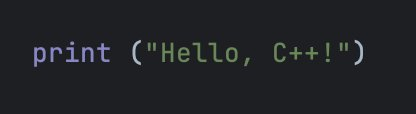

# MME

Task `mme`, tokenizer `Qwen/Qwen2.5-VL-3B-Instruct`.

| | |
|---|---|
| Questions (distinct images) | 2,374 (1,187) |
| Image size, MP, avg (min–max) | 1.88 (0.01–33.41), avg 1086×945 px |
| Image tokens, avg (min–max) | 867.6 (256–2,048) |
| Question tokens (prompt text), avg (min–max) | 22.3 (15–41) |
| Reference answer words, avg (min–max) | 1.00 (1–1) |
| Reference answer tokens, avg (min–max) | 1.00 (1–1) |
| Reference answers of one word / with a digit | 100% / 0% |
| Scoring | exact match on "Yes"/"No" (the answer's first word); perception and cognition scores sum accuracy and accuracy+ per category |

## Examples

### doc 0

| | |
|---|---|
| Image | 416×114 px → resized 868×252 px → 279 image tokens |
| Prompt (19 tokens) | Is a python code shown in the picture? Answer the question using a single word or phrase. |
| Reference | "Yes" |
| Reference tokens | `Yes` |

### doc 2373

| | |
|---|---|
| Image | 429×599 px → resized 420×588 px → 315 image tokens |
| Prompt (23 tokens) | Is this movie originated from the country or region of venezuela? Answer the question using a single word or phrase. |
| Reference | "No" |
| Reference tokens | `No` |
