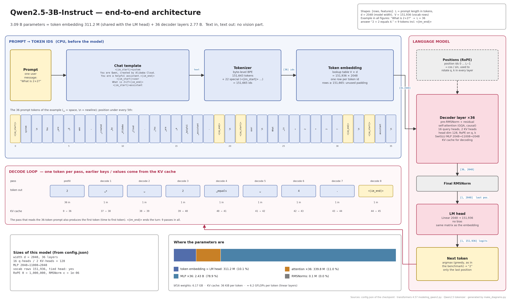
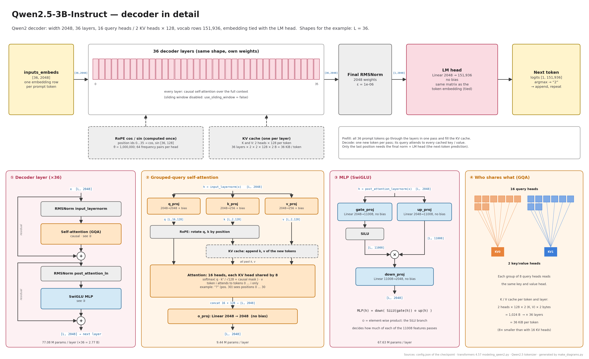
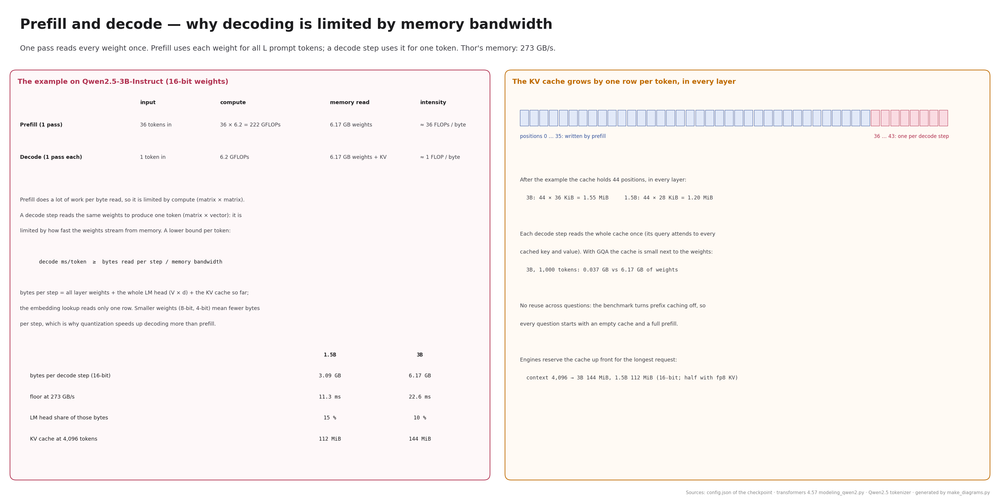
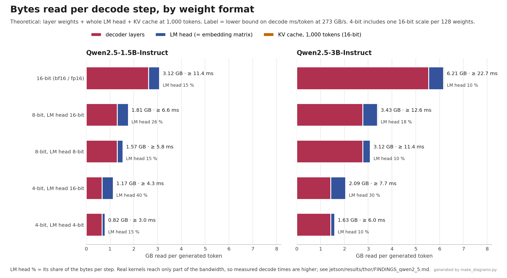
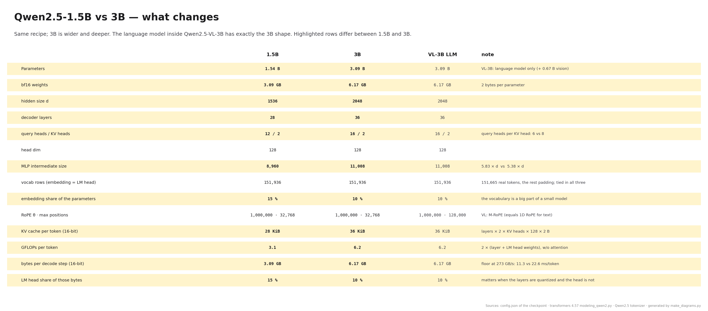

# Qwen2.5-1.5B / 3B-Instruct (text only): architecture, step by step

Teaching material for the two text models benchmarked in `jetson/` ([../model.sh](../model.sh)). One example runs through all the pages: the user message **"What is 2+2?"**, which becomes **36 prompt tokens**, and the answer **"2 + 2 equals 4."**, which is 9 generated tokens (8 + the end-of-turn token). All tensor shapes below are for that example.

All figures are in [figures/](figures/) as PNG and SVG. [qwen2_5_architecture.pdf](qwen2_5_architecture.pdf) holds all of them, one page each, in teaching order.

| # | Figure | Content |
|---|--------|---------|
| 1 | [01_overview_1.5b](figures/01_overview_1.5b.png) · [01_overview_3b](figures/01_overview_3b.png) | Prompt → tokens → decoder → next token, the decode loop, parameter split |
| 2 | [02_decoder_1.5b](figures/02_decoder_1.5b.png) · [02_decoder_3b](figures/02_decoder_3b.png) | Decoder layer, GQA attention, SwiGLU MLP, KV cache |
| 3 | [03_prefill_decode](figures/03_prefill_decode.png) | Prefill vs decode, why decoding is bandwidth-bound, KV cache growth |
| 4 | [04_bytes_per_token](figures/04_bytes_per_token.png) | Bytes read per decode step per weight format; LM head share |
| 5 | [05_1.5b_vs_3b](figures/05_1.5b_vs_3b.png) | Side-by-side comparison, with the language model of Qwen2.5-VL-3B |

**How accurate is it?** The script ([make_diagrams.py](make_diagrams.py)) builds every figure from the checkpoints' `config.json` (copies in [configs/](configs/)). It checks the parameter counts it derives against the safetensors headers in the HF cache, and they match exactly (1,543,714,304 and 3,085,938,688). The layer structure follows `transformers` 4.57 `modeling_qwen2.py`. The token ids of the example were produced with the real tokenizer and chat template, and the answer is what the 3B model returns (greedy, in the Edge-LLM runner). To rebuild, run `python3 jetson/models/qwen2_5/docs/make_diagrams.py`; it needs only matplotlib and numpy and reuses the drawing kit of the [Qwen2.5-VL diagrams](../../qwen2_5_vl/docs/README.md).

## 1. The big picture

Qwen2.5-Instruct is a decoder-only transformer. Text goes in, text comes out:

1. The **chat template** wraps the message in role markers. With no system message, Qwen2.5's template adds its default one, "You are Qwen, created by Alibaba Cloud. You are a helpful assistant." Every framework in the benchmark uses this same template and system prompt.
2. The **tokenizer** (byte-level BPE, 151,643 tokens + 22 special ones such as `<|im_start|>`) turns the text into ids. The example gives **L = 36** ids: 21 for the system turn (with its newline), 12 for the user turn (`What`, `␣is`, `␣`, `2`, `+`, `2`, `?` and the markers), 3 for the start of the assistant turn.
3. The **token embedding** looks up one row of a V × d table per id: `[36] → [36, d]`.
4. The **decoder** (28 layers in 1.5B, 36 in 3B) runs all 36 tokens together with causal attention.
5. The **final RMSNorm** and the **LM head** turn the last position into logits over V = 151,936 rows. The highest one is token `2`.
6. The new token is embedded and fed back, one token per pass, reusing the **KV cache**, until the model emits `<|im_end|>`.

Compared with Qwen2.5-VL, this is the VL model's language model with nothing in front of it: no image processor, no vision encoder, no patch merger, and plain 1D RoPE positions.

## 2. Tokens

| Pos. | Tokens | Meaning |
|------|--------|---------|
| 0–20 | `<\|im_start\|>` `system` `\n` `You` `␣are` `␣Q` `wen` `,` … `␣assistant` `.` `<\|im_end\|>` `\n` | default system turn |
| 21–32 | `<\|im_start\|>` `user` `\n` `What` `␣is` `␣` `2` `+` `2` `?` `<\|im_end\|>` `\n` | the user turn |
| 33–35 | `<\|im_start\|>` `assistant` `\n` | the model answers from here |
| 36–44 | `2` `␣+` `␣` `2` `␣equals` `␣` `4` `.` `<\|im_end\|>` | generated, one per pass |

Digits are always single tokens (`2`, `4`), and a space before a digit is its own token (`␣`). A question with numbers therefore takes more tokens than its word count suggests.

## 3. Decoder

Every decoder layer is pre-norm with two residual branches: `x + Attn(RMSNorm(x))`, then `+ MLP(RMSNorm(·))`.

- **Attention (GQA)**: `q_proj` d→d, `k_proj` and `v_proj` d→256 (2 KV heads × 128), all **with bias**; `o_proj` d→d **without bias**. RoPE (θ = 10⁶) rotates q and k by the token's position. Attention is causal: token i sees tokens 0…i.
- **Grouped-query attention**: the query heads share 2 key/value heads, 6 queries per KV head in 1.5B (12 heads) and 8 in 3B (16 heads). Only K and V are cached, so the cache is small: **28 KiB per token** in 1.5B and **36 KiB** in 3B (16-bit), i.e. 112 / 144 MiB for a full 4,096-token context.
- **MLP**: SwiGLU without bias, `down(SiLU(gate(h)) ⊙ up(h))`, 1536→**8960**→1536 (1.5B) and 2048→**11008**→2048 (3B). The MLP holds 79 % of the 3B parameters.
- **Head**: final RMSNorm, then the LM head d→V. In both sizes the **LM head is the embedding matrix** (`tie_word_embeddings: true`). V = 151,936 rows; ids ≥ 151,665 are padding.
- **Sliding window**: the config has `sliding_window` fields, but `use_sliding_window` is false, so every layer attends over the full context.

## 4. Prefill and decode

The model makes two kinds of pass:

- **Prefill**: all 36 prompt tokens in one pass. It fills the KV cache and produces the first output token, so its duration is the time to first token (TTFT). Each weight is used for 36 tokens, about 36 FLOPs per byte read: prefill is limited by compute.
- **Decode**: one token per pass, 8 more passes in the example. Each pass reads every layer weight and the whole LM head (only one embedding row) to produce one token, about 1 FLOP per byte: decode is limited by memory bandwidth.

On Thor (273 GB/s), a 16-bit decode step reads 3.09 GB (1.5B) or 6.17 GB (3B), so it can't be faster than **11.3 ms** or **22.6 ms** per token. That is why smaller weights speed up decoding much more than prefill.

The benchmark turns prefix caching off in every framework, so each question starts with an empty cache and a full prefill.

## 5. Bytes per decode step and the LM head

Quantization shrinks the decoder layers, but frameworks often keep the LM head in 16 bits (Edge-LLM's default; `--lm_head_quantization` changes it). Because the vocabulary is large and the models are small, the head is then a big part of every decode step:

| | 1.5B | 3B |
|---|---|---|
| LM head = embedding, parameters | 233 M (15 %) | 311 M (10 %) |
| LM head share of the bytes, 16-bit model | 15 % | 10 % |
| … 8-bit layers, 16-bit head | 26 % | 18 % |
| … 4-bit layers, 16-bit head | 40 % | 30 % |

The figure's floors (bytes / 273 GB/s) are lower bounds. The measured decode times and the bandwidth the frameworks actually reach are in [FINDINGS_qwen2_5.md](../../../results/thor/FINDINGS_qwen2_5.md).

## 6. 1.5B vs 3B

3B is both wider (2048 vs 1536) and deeper (36 vs 28 layers); both keep 2 KV heads of 128. Per token, 3B does twice the work and reads twice the bytes. The language model inside **Qwen2.5-VL-3B has exactly the 3B shape** (same width, layers, heads, MLP and vocabulary; weights trained separately), so the text-only 3B results can be compared directly with the language-model part of the VL study.
