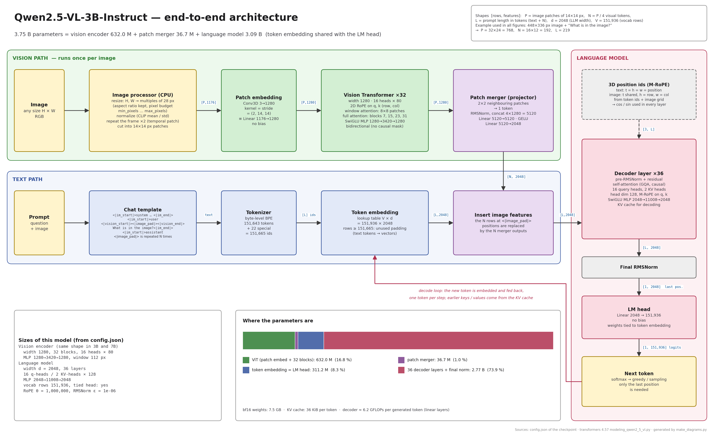
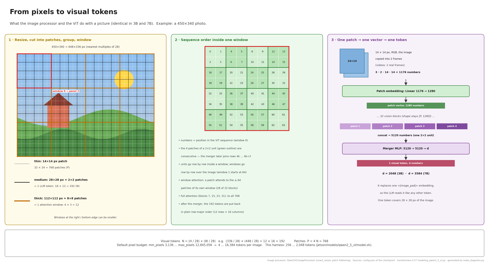
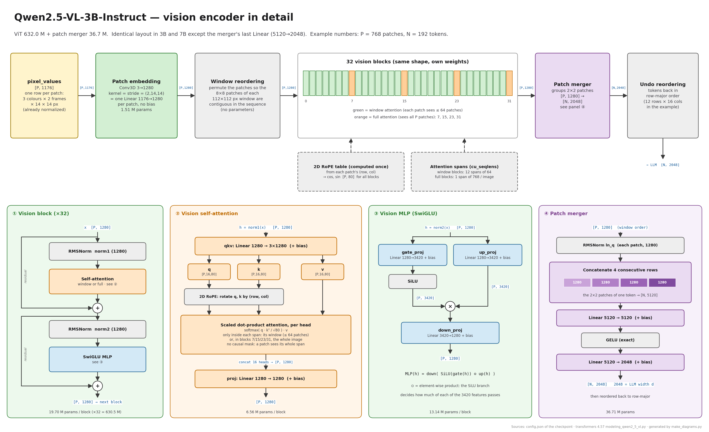
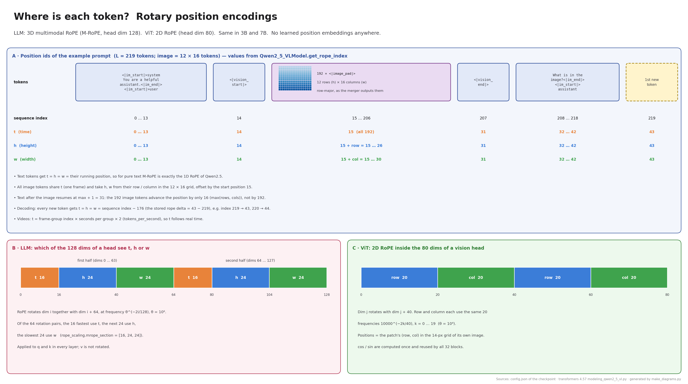
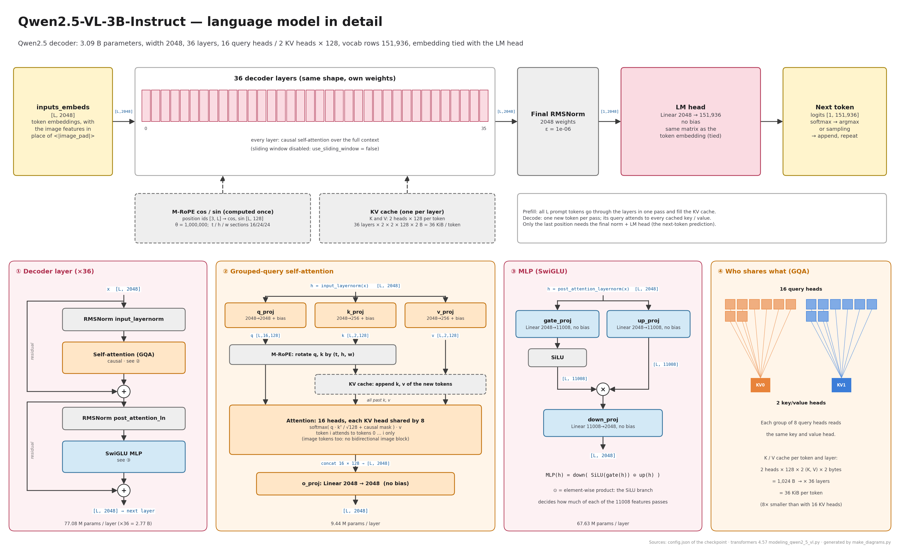
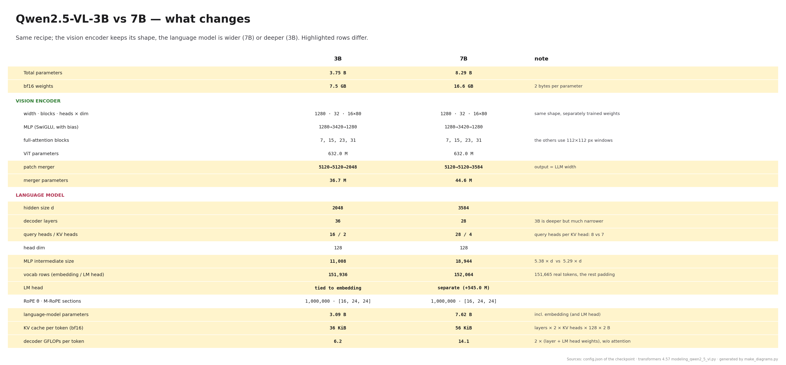

# Qwen2.5-VL-3B / 7B: architecture, step by step

Teaching material for the two models benchmarked in `jetson/`. One example runs through all the pages: a **448×336 px image** with the question **"What is in the image?"**. All tensor shapes and position numbers below are for that example.

All figures are in [figures/](figures/) as PNG and SVG. [qwen2_5_vl_architecture.pdf](qwen2_5_vl_architecture.pdf) holds all of them, one page each, in teaching order.

| # | Figure | Content |
|---|--------|---------|
| 1 | [01_overview_3b](figures/01_overview_3b.png) · [01_overview_7b](figures/01_overview_7b.png) | End-to-end data flow, parameter split |
| 2 | [02_pixels_to_tokens](figures/02_pixels_to_tokens.png) | Resize, patches, 2×2 units, windows, token order |
| 3 | [03_vision_encoder_3b](figures/03_vision_encoder_3b.png) · [03_vision_encoder_7b](figures/03_vision_encoder_7b.png) | ViT block, vision attention, vision MLP, patch merger |
| 4 | [04_positions_mrope](figures/04_positions_mrope.png) | M-RoPE position ids (real values), 2D RoPE in the ViT |
| 5 | [05_language_model_3b](figures/05_language_model_3b.png) · [05_language_model_7b](figures/05_language_model_7b.png) | Decoder layer, GQA attention, MLP, KV cache |
| 6 | [06_3b_vs_7b](figures/06_3b_vs_7b.png) | Side-by-side comparison of the two sizes |

**How accurate is it?** The script ([make_diagrams.py](make_diagrams.py)) builds every figure from the checkpoints' `config.json` (copies in [configs/](configs/)). It checks the parameter counts it derives against the safetensors headers in the HF cache, and they match exactly (3,754,622,976 and 8,292,166,656). The layer structure (bias or no bias, where norms and RoPE sit, window and full attention, merger) follows `transformers` 4.57 `modeling_qwen2_5_vl.py`. The token ids and M-RoPE positions of the example were produced with the real processor and `get_rope_index`. To rebuild, run `python3 jetson/models/qwen2_5_vl/docs/make_diagrams.py`; it needs only matplotlib and numpy.

## 1. The big picture

Qwen2.5-VL is a **vision encoder** (a ViT) and a **language model** (the Qwen2.5 decoder), joined by a small **patch merger** MLP:

1. The **image processor** (CPU) resizes the image and cuts it into P patches of 14×14 px.
2. The **vision encoder** turns every patch into a 1280-d vector and refines it through 32 transformer blocks.
3. The **patch merger** joins each 2×2 group of neighbouring patches into one vector of the LLM's width d. That gives N = P/4 *visual tokens*.
4. The prompt is tokenized. It contains one `<|image_pad|>` placeholder per visual token. After the embedding lookup, those N rows are **overwritten** by the N merger outputs.
5. The **decoder** (36 layers in 3B, 28 in 7B) processes text and image tokens together with causal attention. Every token gets a 3D position (M-RoPE).
6. The **LM head** turns the last position into logits over the vocabulary. The next token is appended and the loop repeats, reusing the KV cache.

Nothing else connects the two models: the LLM sees image tokens only as ordinary rows in its input sequence.

## 2. From pixels to visual tokens

- **Resize** (`smart_resize`): H and W are rounded to multiples of **28 px** (= 2 patches) while keeping the aspect ratio. The image is scaled so that H·W stays between `min_pixels` (3,136) and `max_pixels` (12,845,056). This harness narrows the range to 256…2,048 tokens ([../model.sh](../model.sh)). In the example, 450×340 becomes 448×336.
- **Patches**: 14×14 px. The processor makes 2 copies of each image frame, because the patch embedding is a 3D convolution built for video (temporal patch size 2). One patch is therefore 3 colours × 2 frames × 14 × 14 = **1176 numbers**, and `pixel_values` has shape `[P, 1176]`. Example: 32 × 24 = **768 patches**.
- **Order**: the processor already lists the 4 patches of every 2×2 unit next to each other. The ViT then reorders the units so that each **112×112 px window** (8×8 patches = 4×4 tokens) is contiguous. Window attention can then work on contiguous slices of the sequence.
- **Tokens**: N = (H/28)·(W/28). Example: 12 × 16 = **192 visual tokens**. One token covers 28×28 px.

## 3. Vision encoder (same shape in 3B and 7B)

| Part | What it does | Shapes / sizes |
|------|--------------|----------------|
| Patch embedding | `Conv3d(3→1280, kernel = stride = (2,14,14), bias=False)`, equivalent to one Linear 1176→1280 per patch | `[P,1176] → [P,1280]`, 1.51 M |
| 2D RoPE | Rotary positions from each patch's (row, col), computed once and used by all blocks | cos/sin `[P,80]` |
| 32 × vision block | Pre-norm: `x + Attn(RMSNorm(x))`, then `x + MLP(RMSNorm(x))` | 19.70 M each |
| Attention | `qkv` Linear 1280→3840 (+bias), 16 heads × 80, `proj` 1280→1280 (+bias), **no causal mask** | 6.56 M |
| Window / full | Blocks **7, 15, 23, 31** attend over the whole image. The other 28 attend only inside their 112-px window (≤ 64 patches) | `cu_seqlens` |
| MLP | SwiGLU **with bias**: `down(SiLU(gate(h)) ⊙ up(h))`, 1280→**3420**→1280 | 13.14 M |
| Patch merger | RMSNorm per patch, concat 4 patches → 5120, Linear 5120→5120 (+bias), GELU, Linear 5120→d (+bias) | `[P,1280] → [N,d]`, 36.7 M / 44.6 M |
| Undo reordering | Puts the N tokens back in row-major order | `[N,d]` |

Why use window attention? Full attention costs O(P²). With 64-patch windows, 28 of the 32 blocks cost O(P·64). The 4 full-attention blocks still let information travel across the whole image.

## 4. Positions: M-RoPE and 2D RoPE

Neither model has learned position embeddings. Positions enter only by rotating q and k (RoPE).

- **ViT, 2D RoPE**: each 80-dim head is split into 20 dims rotated by the patch's row and 20 by its column, twice (the two halves of RoPE's rotate-half pairing). θ = 10⁴.
- **LLM, M-RoPE**: each token has three position ids (t, h, w). The 64 rotation pairs of a 128-dim head are split by `mrope_section = [16, 24, 24]`: the 16 fastest frequencies follow t, the next 24 follow h, the slowest 24 follow w. θ = 10⁶.
  - Text tokens: t = h = w = running position, so for pure text this is exactly ordinary 1D RoPE.
  - Image tokens: t is the same for all of them; h and w are the row and column in the token grid, plus the start offset.
  - After an image, text resumes at max + 1. In the example, the 192 image tokens use positions 15…30, `<|vision_end|>` gets 31, and the first generated token gets **43** although its sequence index is 219. The model keeps that offset as `rope_deltas` (−176) for decoding.

## 5. Language model

Every decoder layer follows the same pre-norm residual pattern as the vision block:

- **Attention (GQA)**: `q_proj` d→d, `k_proj` and `v_proj` d→(KV heads × 128), all **with bias**; `o_proj` d→d **without bias**. M-RoPE rotates q and k. Attention is **causal** over all tokens, image tokens included. Several query heads share one KV head: 8 per KV head in 3B (16/2), 7 in 7B (28/4). This makes the KV cache small: **36 KiB/token** (3B) and **56 KiB/token** (7B) in bf16.
- **MLP**: SwiGLU **without bias**, 2048→**11008**→2048 (3B) and 3584→**18944**→3584 (7B).
- **Head**: final RMSNorm, then the LM head d→V. In **3B the LM head is the token-embedding matrix itself** (`tie_word_embeddings: true`); 7B has a separate 545 M matrix. V (151,936 / 152,064) is larger than the 151,665 real token ids; the extra rows are padding.
- **Prefill vs decode**: prefill runs all L prompt tokens in one pass and fills the KV cache. Each decode step runs a single token. Only the last position needs the LM head.

## 6. 3B vs 7B

The vision encoder has the same shape in both sizes (632 M, weights trained separately). Only the merger's output width follows the LLM. The 3B language model is **deeper** (36 layers) but much **narrower** (2048 vs 3584) than the 7B.

## Differences from the earlier slides

If you reuse the earlier Qwen2.5-VL slides, fix these points. Each one is verified against the weights or the source:

| Earlier slide | Correct |
|---------------|---------|
| Vision MLP 1280→**3456**→1280 | 1280→**3420**→1280 (`vision_config.intermediate_size`) |
| 3B decoder MLP 2048→**4864**→2048 | 2048→**11008**→2048 |
| Projector input **1280**, `Linear 1280→1280`, `Linear 1280→out` | Input is **4 patches concatenated = 5120**: RMSNorm(1280 per patch), Linear **5120→5120**, GELU, Linear **5120→out**. This is where 4 patches become 1 token |
| "Full attention in last layer" | Full attention in blocks **7, 15, 23, 31** (`fullatt_block_indexes`); transformers implements this |
| RoPE drawn as a block after patch embedding / token embedding | RoPE does not change the hidden state. It rotates **q and k inside every attention layer** (2D in the ViT, 3D M-RoPE in the LLM) |
| Output **151646** | LM head output = **151,936** (3B) / **152,064** (7B) rows; the tokenizer has 151,665 ids |
| Only the 3B shows "shared weights" | Correct for 3B (tied); 7B is **not** tied |
| MLP shown as `Linear → SiLU`, `Linear`, `×`, `Linear` with no bias info | Vision MLP layers **have bias**; decoder MLP layers **don't**. In the decoder, q/k/v have bias and o_proj doesn't |
| Self-attention "2 KV heads" (3B) / "4 KV heads" (7B) | Correct; add the query heads: 16 (3B) / 28 (7B), head dim 128 |
