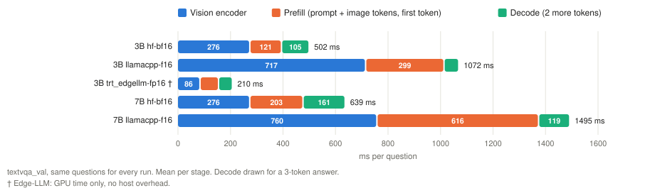
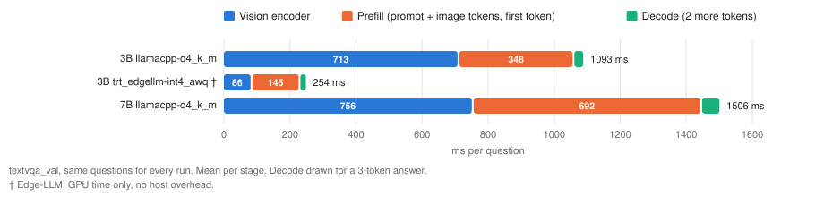
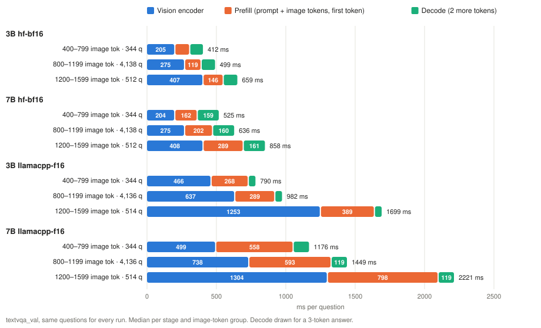

# Jetson Thor: what we did and what we found

## What we did

We ran the vision-language model **Qwen2.5-VL** (a small 3B and a larger 7B version) on an **NVIDIA Jetson AGX Thor** board. We ran it through four inference programs ("frameworks"):

- **HF** (Hugging Face transformers): the plain reference.
- **vLLM**: a fast server engine.
- **llama.cpp**: a lightweight engine popular for small devices.
- **TensorRT Edge-LLM**: NVIDIA's engine built for Jetson.

We also compared **precisions**. A model can store its numbers in full size (bf16/fp16) or compressed to 8 or 4 bits. Compressed models are smaller and can be faster, but may lose accuracy.

We tested on three benchmarks (numbers from [jetson/datasets/reports](../../datasets/reports/)):

| Benchmark | Questions (images) | Image size, avg (min–max) | Image tokens, avg (min–max) | Question tokens, avg (min–max) | Reference answer: words / tokens, avg (min–max) | Content | Scoring |
|---|---:|---|---:|---:|---:|---|---|
| [TextVQA](../../datasets/reports/textvqa_val.md) | 5,000 (3,166) | 0.77 MP, ~950×820 px (0.26–15.9 MP) | 977 (333–2,028) | 18 (13–49) | 1.6 (1–12) / 2.9 (1–22) | text in photos | VQA accuracy: min(1, matching human answers / 3), out of 10 |
| [MME](../../datasets/reports/mme.md) | 2,374 (1,187) | 1.88 MP, ~1090×950 px (0.01–33.4 MP) | 868 (256–2,048) | 22 (15–41) | 1 / 1 ("Yes" or "No") | yes/no questions | the answer's first word is "Yes"/"No"; score = accuracy + accuracy+ per category |
| [GQA](../../datasets/reports/gqa.md) | 12,578 (398) | 0.28 MP, ~580×480 px (0.10–0.41 MP) | 358 (260–529) | 20 (14–36) | 1.1 (1–3) / 1.3 (1–4) | objects in scenes | exact match |

- **Image tokens:** one per 28×28 px, after resizing into 256–2,048 tokens (e.g. 1024×1024 px → 1036×1036 → 1,369 tokens).
- **Question tokens:** the full prompt text, e.g. "Is it overcast?" + "Answer the question using a single word or phrase." = 15 tokens. MME's own "Please answer yes or no." is replaced by this suffix.
- **Reference answer:** for TextVQA, the most common of its 10 human answers; 72% are one word, 24% contain a digit. GQA: 94% one word.
- **Words ≠ tokens:** rare words split into pieces and every digit is a token.

Shortest and longest reference answer in tokens (images and details in the reports):

| Benchmark | Question | Reference | Words / tokens |
|---|---|---|---:|
| TextVQA | What kind of beer is this? | ale | 1 / 1 |
| TextVQA | What brands of beer are there here? | caracu, antartica, itaipava, evassa, paulistania, petra | 6 / 22 |
| MME | every question, e.g. Is a python code shown in the picture? | Yes / No | 1 / 1 |
| GQA | Is it overcast? | no | 1 / 1 |
| GQA | Who rides on the skateboard? | skateboarder (`sk` `ate` `board` `er`) | 1 / 4 |

Regenerate with `jetson/datasets/run.sh <textvqa|mme|gqa>`; add `--run <run dir>` for the model's answers, `--examples <doc id> ...` for other questions.

For every run we measured accuracy, speed, energy, memory and compute. All frameworks got the same images and the same questions, and ran one question at a time with nothing else on the GPU.

## What we found

### 1. What we measured

Full runs at MAXN (the uncapped power mode; 120 W is the board's default capped mode). T = TextVQA, M = MME, G = GQA.

| Weights | Model | HF | vLLM | llama.cpp | Edge-LLM |
|---|---|---|---|---|---|
| 16-bit | 3B | bf16: T (M, G at 120 W) | bf16: T (M, G at 120 W) | f16: T | fp16: T M G |
| 16-bit | 7B | bf16: T (M, G at 120 W) | bf16: T (M, G at 120 W) | f16: T | fp16: T |
| 8-bit int | 3B, 7B | – | – | Q8_0: T | – |
| 8-bit fp8 | 3B | – | – | not possible (no fp8 in GGUF) | fp8: T M G |
| 8-bit fp8 | 7B | – | – | not possible | fp8: T |
| 4-bit | 3B | – | Qwen AWQ: T (M, G at 120 W) | Q4_K_M: T | int4_awq (own): T M G |
| 4-bit | 7B | – | Qwen AWQ: T (M, G at 120 W) | Q4_K_M: T | int4_awq (own): T |

Only TextVQA has the same configuration in several frameworks: 16-bit in all four, for both sizes; sections 2 and 3 use it. The gaps can be filled: 8-bit checkpoints exist for HF and vLLM (RedHatAI int8 and fp8, NVIDIA fp8 for the 7B).

### 2. Frameworks on the same configuration

The same 5,000 TextVQA questions, MAXN.

- **TTFT** (time to first token): model call → first answer token. Median; Edge-LLM: mean GPU time.
- **Energy per question:** average board power × run time ÷ questions (includes image preparation and gaps).

**16-bit weights and activations, 3B:**

| Framework | Weights | Accuracy (Δ vs HF) | TTFT | Decode per token | Questions/s | Avg board power | Energy per question |
|---|---|---:|---:|---:|---:|---:|---:|
| HF | bf16 | 78.9 (–) | 0.40 s | 53 ms | 1.72 | 67 W | 39 J |
| vLLM | bf16 | 79.4 (+0.5 ± 0.2) | 0.36 s | 27 ms | 1.43 | 52 W | 37 J |
| llama.cpp | f16 | 79.8 (+1.0 ± 0.4) | 1.06 s | 28 ms | 0.69 | 53 W | 77 J |
| Edge-LLM | fp16 | 79.5 (+0.6 ± 0.2) | ~0.16 s | 27 ms | 2.04 | 59 W | 29 J |

**16-bit weights and activations, 7B:**

| Framework | Weights | Accuracy (Δ vs HF) | TTFT | Decode per token | Questions/s | Avg board power | Energy per question |
|---|---|---:|---:|---:|---:|---:|---:|
| HF | bf16 | 83.0 (–) | 0.48 s | 80 ms | 1.30 | 73 W | 56 J |
| vLLM | bf16 | 83.8 (+0.9 ± 0.2) | 0.46 s | 63 ms | 1.12 | 62 W | 56 J |
| llama.cpp | f16 | 82.6 (−0.4 ± 0.3) | 1.45 s | 59 ms | 0.52 | 59 W | 114 J |
| Edge-LLM | fp16 | 84.0 (+1.0 ± 0.2) | ~0.25 s | 59 ms | 1.48 | 70 W | 47 J |

**4-bit weights, 16-bit activations, 3B** (same bits, different quantizers; HF not run):

| Framework | Weights | Accuracy (Δ vs HF bf16) | TTFT | Decode per token | Questions/s | Avg board power | Energy per question |
|---|---|---:|---:|---:|---:|---:|---:|
| vLLM | AWQ (by Qwen) | 79.1 (+0.2 ± 0.3) | 0.45 s | 11 ms | 1.34 | 53 W | 40 J |
| llama.cpp | Q4_K_M (by ggml-org) | 78.7 (−0.1 ± 0.4) | 1.14 s | 16 ms | 0.68 | 49 W | 72 J |
| Edge-LLM | int4_awq (own) | 73.8 (**−5.1 ± 0.5**) | ~0.23 s | 11 ms | 1.92 | 59 W | 31 J |

- **Accuracy:** at 16-bit, all within 1 point; the differences are close calls about when to stop answering ("Stop" vs "Stop Global Warming"). At 4-bit it depends on who quantized the model (section 4).
- **TTFT:** Edge-LLM < vLLM ≈ HF < llama.cpp, for both sizes and both weight formats. Edge-LLM's lead is its vision encoder (section 3).
- **Decode speed is set by the weight size, not the framework:** at 16-bit 27–28 ms per token for the 3B and 59–63 ms for the 7B (vLLM, llama.cpp, Edge-LLM), at 4-bit 11–16 ms (3B) and 20–29 ms (7B), because each token reads all weights. HF is the exception (53 / 80 ms, framework overhead).
- **llama.cpp f16 vs Q8_0** (same GGUF converter, same f16 vision encoder, only the language model's weights differ):
  - Accuracy: the same. Q8_0 − f16 = +0.02 ± 0.11 (3B), −0.19 ± 0.11 (7B); about 50 of 5,000 answers differ.
  - Decode: **Q8_0's faster decode comes from its 8-bit weights.** 18 vs 28 ms per token (3B, 1.5×), 35 vs 59 ms (7B, 1.7×). At f16 each token reads ~6.2 / ~15.2 GB, i.e. 220 / 256 GB/s of Thor's 273 GB/s. At f16, llama.cpp decodes as fast as vLLM and Edge-LLM.
  - TTFT: **unchanged.** 1.06 vs 1.09 s (3B), 1.45 vs 1.43 s (7B). The vision encoder is the same, and the ~1,000-token prefill is compute-bound, so f16 is even 5–9% faster there (no unpacking: 289 vs 319 ms, 594 vs 620 ms). llama.cpp's slow TTFT is its vision encoder and prefill kernels, not its weight format.
  - Energy: f16 costs a little more per question (77 vs 72 J for 3B, 114 vs 100 J for 7B), from the slower decode and higher power draw.
  - Earlier versions of this file gave 12 / 11 ms per token for Q8_0 / Q4_K_M. That came from llama-server's own per-token figure, which counts the first token as a decode step. Measured on the client side, the numbers are 18 / 16 ms.
- **7B at 16-bit:** the same ranking as the 3B. Edge-LLM fp16 and vLLM bf16 score the same (+0.1 ± 0.2 apart); Edge-LLM answers in about half vLLM's TTFT and uses 47 vs 56 J per question.
- **Questions/s:** vLLM, llama.cpp and Edge-LLM convert every image to PNG first (~0.24 s per question). So vLLM answers fewer questions per second than HF despite a lower TTFT, and Edge-LLM only 1.2× more.
- **Energy follows time:** board power differs little (49–67 W), time per question a lot.
- **Is the data enough?** Accuracy: yes (standard error 0.2–0.5 points over 5,000 paired questions). Ranking: yes, the gaps (2–7×) are far larger than run-to-run variation (~8%). Exact times: less so (one run per setting, Edge-LLM GPU time only, vLLM no stage breakdown).

### 3. Where the time goes

Per question: the **vision encoder** turns the image into tokens; the **prefill** runs the language model over all input tokens and produces the first token; **decode** produces each further token. Same 5,000 TextVQA questions, mean per stage:

**16-bit:**

**4-bit:**

**By image size** (HF bf16 and llama.cpp f16, median per stage):

| Image tokens | Typical image | Questions | HF 3B vision / prefill | HF 7B vision / prefill | llama.cpp f16 3B vision / prefill | llama.cpp f16 7B vision / prefill |
|---:|---|---:|---:|---:|---:|---:|
| 740 | 1024×576 px | 344 | 205 / 107 ms | 204 / 162 ms | 466 / 268 ms | 499 / 558 ms |
| 999 | 1024×768 px | 4,138 | 275 / 119 ms | 275 / 202 ms | 637 / 289 ms | 738 / 593 ms |
| 1,369 | 1024×1024 px | 512 | 407 / 146 ms | 408 / 289 ms | 1,253 / 389 ms | 1,304 / 798 ms |
| 2,028 | 2560×3008 px (shrunk) | 5 | 630 / 221 ms | 627 / 389 ms | 2,581 / 520 ms | 2,604 / 1,046 ms |

llama.cpp rounds two images to a slightly different token count, so its middle groups have 4,136 and 514 questions.

vLLM reports no stages; Edge-LLM only means, so it can't be split by image size. Figures: [plot_stages.py](../../scripts/plot_stages.py), e.g. `jetson/scripts/plot_stages.py 3b:hf-bf16 3b:trt_edgellm-fp16 -o out.svg` (`--by-size` for the last form).

- **The vision encoder is the longest stage** in every framework. It is the same for 3B and 7B; only prefill and decode grow with the model.
- **Image size drives TTFT:** 1.85× more image tokens → 2.0× longer vision encoder in HF (2.7× in llama.cpp), 1.4–1.8× longer prefill. Pixels count only through tokens (large photos are shrunk to 2,048).
- **Edge-LLM's vision encoder is 3× faster than HF's and 8× faster than llama.cpp's** (86 vs 276 vs ~710 ms), the same for 3B and 7B.
- **4-bit makes the first token slower:** Edge-LLM prefill 145 vs 71 ms (3B) and 310 vs 159 ms (7B), vLLM TTFT 0.45 vs 0.36 s (3B). 4-bit weights must be unpacked for every prefill; only decode gets faster. **fp8 (8-bit weights and activations) speeds up prefill:** 43 ms (3B), 93 ms (7B).
- **Answers are short, but decode is not negligible in time.** The model generates 2.0 (MME), 2.3 (GQA) and 4.1 (TextVQA) tokens on average, including the end token (max 16 / 6 / 118). Decode is < 0.2% of the FLOPs but 16–26% of HF's model time, because each step is slow (memory-bound, plus HF overhead). Longer answers (captions) would make decode the largest stage.
- **Hidden cost:** converting each photo to PNG (~0.24 s) takes about as long as the model itself; HF passes the image directly (0.03 s).

### 4. 4-bit: who compressed the model matters more than the number of bits

All compressed models here are **post-training quantization (PTQ)**: the weights are rounded after training, without retraining. Only the language model is compressed; the vision encoder stays 16-bit everywhere.

| Model | Method | Compressed by | Calibration data | Accuracy change (TextVQA) |
|---|---|---|---|---:|
| fp8 (Edge-LLM) | 8-bit weights and activations | Edge-LLM's quantizer (NVIDIA ModelOpt) | news text | +0.1 (3B), −0.1 (7B): none |
| AWQ 4-bit (vLLM) | 4-bit weights, 16-bit activations | Qwen (official checkpoint) | not published | −0.3 (3B), −0.7 (7B) |
| AWQ 4-bit (Edge-LLM) | 4-bit weights, 16-bit activations | Edge-LLM's quantizer | news text | **−5.7** (3B; also −2.5 GQA, −49 MME reasoning), −1.1 (7B) |
| GGUF Q4_K_M vs Q8_0 (llama.cpp) | block-wise weight rounding | ggml-org | not documented | −1.1 (3B), −0.2 (7B) |

The two AWQ models use the same method and the same 4 bits, yet lose −0.3 vs −5.7 points on the 3B. AWQ uses sample inputs to decide which weights to keep precise. Edge-LLM's quantizer only shows it news text, so it most likely does not protect the weights that matter for image tokens and reading text. The 7B suffers much less from the same quantizer (−1.1 vs its own fp16), so the larger model tolerates the poor calibration better. **fp8 is free; for 4-bit, use Qwen's AWQ checkpoint** (it doesn't run in Edge-LLM yet: empty answers on image prompts).

### 5. Best choices

TextVQA, MAXN, among what we measured:

| Model | Use | Accuracy | TTFT | Energy per question | FLOPs to first token |
|---|---|---:|---:|---:|---:|
| 3B | **Edge-LLM fp8** | 79.6% | ~0.13 s | 23 J | 11.2 TFLOP |
| 7B | **Edge-LLM fp8** | 83.9% | ~0.18 s | 34 J | 18.9 TFLOP |

- **FLOPs to first token:** analytical, vision encoder + prefill ([methodology](../../docs/methodology.md#flops)); same in every framework; 3.8–23.9 TFLOP per question (3B), with image size. Each further token adds only 6.5 / 14.5 GFLOP (3B / 7B).
- **Edge-LLM fp8 leads for both sizes.** For the 7B it scores like vLLM bf16 (83.9 vs 83.8%) with 2.5× lower TTFT and 40% less energy; its advantage is the vision encoder, the same in both sizes, plus fp8's faster prefill.
- **7B vs 3B** (Edge-LLM fp8): +4.3 points, +0.05 s TTFT, +11 J per question.

### 6. A bug we found and fixed

In Edge-LLM, about **1 in 5 TextVQA answers came back empty**.

- **Cause:** for some larger photos, numbers inside Qwen's vision encoder grow beyond what 16-bit numbers can hold (over 65,504). They turn into "not a number", and the model then outputs nothing. Edge-LLM can only build this part in 16-bit.
- **Fix:** before building the engine, we scale some of the encoder's weights down by 8. This keeps the numbers in range without changing the result, because the model normalizes them again right after. It costs no accuracy and no speed.
- **Result:** no empty answers anymore. We rebuilt the shared engines and re-ran all Edge-LLM tests. As a side effect, MME is now measured correctly too (1,526 instead of 1,448).
- **Prevention:** our result check now rejects any run with 2% or more empty answers, so this kind of silent failure is caught automatically.

## Things to keep in mind

- **Power mode:** the older HF/vLLM MME and GQA runs used the 120 W power mode; TextVQA and the latest Edge-LLM runs used MAXN (full power). Compare which is faster, not exact times, across the two.
- **Coverage:** see section 1.
- **Build variation:** Edge-LLM speed can vary by about 8% between two builds of the same engine.

## Where to find more

- [REPORT.md](REPORT.md): all the numbers behind these findings, per task and per model.
- [SUMMARY.md](SUMMARY.md): every run, generated automatically; replaced and invalid runs are listed separately, with the reason.
- [NOTES.md](NOTES.md): setup, every problem and its fix, timeline and open items.
