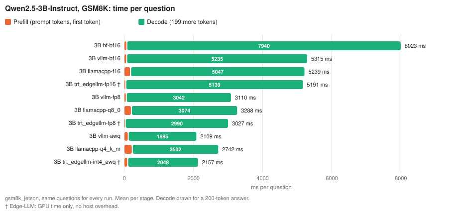

# Jetson Thor, text-only Qwen2.5: what we did and what we found

## What we did

The vision-language study ([FINDINGS.md](FINDINGS.md)) found TensorRT Edge-LLM the best framework for Qwen2.5-VL on Thor. Its lead came largely from the vision encoder. This study asks two questions about a **text-only** model, the plain **Qwen2.5-Instruct** in two sizes (1.5B and 3B):

- **Q1:** is Edge-LLM also the best framework when there is no image?
- **Q2:** which Edge-LLM weight configuration is best for each size?

The 3B text model has exactly the shape of the language model inside Qwen2.5-VL-3B ([architecture walkthrough](../../models/qwen2_5/docs/README.md)), so the two studies can be compared.

The same four frameworks as before: **HF** transformers (the reference), **vLLM**, **llama.cpp** and **TensorRT Edge-LLM**, each at 16, 8 and 4 bits where it has them. Three tasks with different shapes (numbers from [jetson/datasets/reports](../../datasets/reports/)):

| Task | Questions | Prompt tokens, avg (min–max) | Answer tokens, avg (HF 3B) | What it stresses | Scoring |
|---|---:|---:|---:|---|---|
| [GSM8K](../../datasets/reports/gsm8k_jetson.md), 5-shot | 1,319 | 752 (714–879) | 201 | decode: worked arithmetic answers | last number in the answer (flexible-extract) |
| [MMLU](../../datasets/reports/mmlu_jetson.md), 5-shot generative | 14,042 | 738 (282–3,138) | 13 | prefill: long prompt, one-letter answer | first A–D letter, all 57 subjects |
| [IFEval](../../datasets/reports/ifeval.md) | 541 | 75 (42–390) | 330 | long free-form answers that must follow rules | prompt-level strict |

Plus a **controlled-length sweep**: prompts of exactly 128, 512 and 2,048 tokens, each answered with exactly 256 tokens, to separate prefill from decode.

Same conditions for every run: batch 1, greedy decoding, the model's own chat template and system prompt, the same few-shot examples, generation to the end-of-turn token with the same cap, no prompt caching, MAXN power mode, nothing else on the GPU. Accuracy differences are **paired**: every framework answers the same questions, so "Δ vs HF" is the mean per-question difference to HF bf16 ± its standard error. The decision rule for Q1 was written before the first result ([NOTES_qwen2_5.md](NOTES_qwen2_5.md#plan-written-2026-10-08-before-building)).

All numbers: [REPORT_qwen2_5.md](REPORT_qwen2_5.md) (generated from the result files by `python3 jetson/experiments/qwen2_5/report.py`). Every run: [SUMMARY.md](SUMMARY.md).

## What we found

### 1. What we measured

| Weights | HF | vLLM | llama.cpp | Edge-LLM |
|---|---|---|---|---|
| 16-bit | bf16 | bf16 | f16 (GGUF) | fp16 |
| 8-bit | – | fp8 W8A8 (RedHatAI; `torch._scaled_mm`*) | Q8_0 | fp8 (own quantizer) |
| 4-bit | – | AWQ (Qwen's checkpoint) | Q4_K_M | int4_awq (own quantizer) |

All 10 configurations × 3 tasks × 2 sizes ran in full (60 runs), plus 42 sweep runs, repeats on a second day and 20 Edge-LLM weight-study runs. \* vLLM's default fp8 kernel does not run on Thor (SM110); see [FINDINGS.md](FINDINGS.md#1-what-we-measured).

### 2. Frameworks on the same configuration

Time and energy are per question, each framework with its own answers. ✗ = accuracy more than 2 standard errors below HF bf16 (fails the accuracy rule).

**3B**

| Bits | Configuration | GSM8K acc. (Δ) | GSM8K s / J | MMLU acc. (Δ) | MMLU s / J | IFEval acc. (Δ) | IFEval s / J |
|---|---|---|---|---|---|---|---|
| 16 | HF bf16 | 74.5 | 8.07 / 390 | 61.6 | 0.58 / 32 | 60.3 | 13.0 / 615 |
| 16 | vLLM bf16 | 74.1 (−0.3) | 5.38 / 332 | 61.7 (+0.1) | 0.41 / 27 | 59.5 (−0.7) | 8.61 / 516 |
| 16 | llama.cpp f16 | 74.1 (−0.4) | 5.17 / 388 | 61.9 (+0.3) | 0.37 / 27 | 60.3 (+0.0) | 8.10 / 604 |
| 16 | Edge-LLM fp16 | 73.8 (−0.7) | 5.24 / 394 | 61.8 (+0.2) | 0.38 / 30 | 59.3 (−0.9) | 8.34 / 622 |
| 8 | vLLM fp8 | 75.4 (+0.9) | 3.39 / 206 | 61.8 (+0.2) | **0.28 / 18** | 56.9 (−3.3 ✗) | 5.40 / 316 |
| 8 | llama.cpp Q8_0 | 73.4 (−1.1) | 3.20 / 236 | 61.8 (+0.2) | 0.33 / 21 | 58.8 (−1.5) | **4.80 / 356** |
| 8 | Edge-LLM fp8 | 74.4 (−0.1) | **3.03 / 196** | 60.7 (−0.9 ✗) | 0.29 / 20 | 56.4 (−3.9 ✗) | 5.16 / 334 |
| 4 | vLLM AWQ | 72.5 (−2.0) | **2.09 / 146** | 58.7 (−2.9 ✗) | 0.18 / 15 | 58.6 (−1.7) | **3.32 / 221** |
| 4 | llama.cpp Q4_K_M | 72.6 (−1.8) | 2.91 / 215 | 58.6 (−3.0 ✗) | 0.38 / 24 | 59.3 (−0.9) | 4.41 / 329 |
| 4 | Edge-LLM int4_awq | 69.5 (−4.9 ✗) | 2.28 / 161 | 55.4 (−6.2 ✗) | 0.29 / 23 | 58.0 (−2.2) | 3.63 / 254 |

**1.5B**

| Bits | Configuration | GSM8K acc. (Δ) | GSM8K s / J | MMLU acc. (Δ) | MMLU s / J | IFEval acc. (Δ) | IFEval s / J |
|---|---|---|---|---|---|---|---|
| 16 | HF bf16 | 66.7 | 3.90 / 170 | 40.2 | 0.57 / 27 | 41.6 | 8.63 / 363 |
| 16 | vLLM bf16 | 66.7 (+0.0) | 2.08 / **127** | 39.6 (−0.6 ✗) | 0.31 / 20 | 40.5 (−1.1) | 4.37 / **260** |
| 16 | llama.cpp f16 | 64.3 (−2.4 ✗) | 2.41 / 168 | 37.3 (−2.9 ✗) | 0.37 / 26 | 41.4 (−0.2) | 4.89 / 338 |
| 16 | Edge-LLM fp16 | 67.4 (+0.7) | **2.04** / 130 | 38.8 (−1.4 ✗) | 0.29 / 20 | 41.0 (−0.6) | **4.32** / 271 |
| 8 | vLLM fp8 | 66.3 (−0.4) | 1.36 / **79** | 39.4 (−0.7 ✗) | 0.20 / 13 | 41.4 (−0.2) | 2.98 / **170** |
| 8 | llama.cpp Q8_0 | 64.5 (−2.2 ✗) | 1.51 / 102 | 38.1 (−2.1 ✗) | 0.28 / 18 | 41.8 (+0.2) | 2.95 / 201 |
| 8 | Edge-LLM fp8 | 65.1 (−1.6) | **1.30** / 88 | 44.7 (+4.6)† | **0.17 / 12** | 41.8 (+0.2) | **2.74** / 180 |
| 4 | vLLM AWQ | 58.7 (−8.0 ✗) | 1.09 / 70 | 29.1 (−11.1 ✗) | 0.12 / 9 | 37.2 (−4.4 ✗) | 2.39 / 150 |
| 4 | llama.cpp Q4_K_M | 60.6 (−6.1 ✗) | 1.23 / 80 | 38.5 (−1.7 ✗) | 0.27 / 16 | 37.7 (−3.9 ✗) | 2.50 / 162 |
| 4 | Edge-LLM int4_awq | 30.8 (−35.9 ✗)‡ | 1.82 / 127 | 49.9 (+9.7)† | 0.21 / 16 | 36.8 (−4.8 ✗) | 2.51 / 173 |

Bold: lowest time / energy among the configurations of that bit width that pass the accuracy rule.

- **At 16 bits the three fast frameworks are level.** On 3B their times per question are within 4% of each other on GSM8K, 6% on IFEval and 11% on MMLU (llama.cpp's short answers); vLLM uses the least energy (it draws 60–67 W, llama.cpp and Edge-LLM 73–80 W). HF is 1.5–2× slower.
- **At 8 bits Edge-LLM fp8 is the fastest** (GSM8K both sizes, 1.5B MMLU and IFEval), but on 3B its fp8 loses accuracy on IFEval (−3.9) and MMLU (−0.9, just outside 2 SE), like vLLM's fp8 on IFEval (−3.3). llama.cpp Q8_0 is the only 3B 8-bit configuration that passes on IFEval.
- **At 4 bits nothing is safe on 1.5B**: every 4-bit configuration fails on GSM8K and IFEval. On 3B, vLLM AWQ is the best passing 4-bit configuration on GSM8K and IFEval; on MMLU all three fail.
- † **1.5B MMLU rewards direct answers.** The quantized Edge-LLM engines score above HF because they give the letter first more often (fp8: 11,317 answers against HF's 9,139), and direct answers are right more often in this scoring ([NOTES](NOTES_qwen2_5.md#decisions), decision 17). This is a change in behaviour, not more knowledge.
- ‡ **Edge-LLM int4_awq on 1.5B often does not end its turn**: in 39% of GSM8K answers it continues with an invented next question until the cap (decision 15). On MMLU, which scores the first letter, this costs only time.
- **llama.cpp on 1.5B is 2–3 points below the others** on GSM8K and MMLU (not IFEval). Not our cuBLAS setting (an fp32 diagnostic gives the same result); llama.cpp's own numerics on the small model.

### 3. Where the time goes

Decode dominates GSM8K and IFEval, prefill matters for MMLU.

`python3 jetson/scripts/plot_stages.py --task gsm8k_jetson --decode-tokens 199 --xmax 8500 3b:hf-bf16 3b:vllm-bf16 ... -o jetson/results/thor/qwen2_5_time_gsm8k_3b.svg` (the same for `1.5b`, and `--task mmlu_jetson --decode-tokens 12 --xmax 900` for [3B MMLU](qwen2_5_time_mmlu_3b.svg) / [1.5B MMLU](qwen2_5_time_mmlu_1.5b.svg); [1.5B GSM8K](qwen2_5_time_gsm8k_1.5b.svg)).

**Decode is close to the memory-bandwidth limit in every fast framework.** A decode step must read every weight once, so it cannot be faster than bytes per step / 273 GB/s:

`python3 jetson/experiments/qwen2_5/figures.py bandwidth`

| Decode, share of the bandwidth floor reached | 1.5B | 3B |
|---|---|---|
| 16-bit: vLLM / llama.cpp / Edge-LLM | 85 / 74 / 87% | 86 / 90 / 88% |
| 8-bit | 79 / 66 / 80% | 82 / 79 / 84% |
| 4-bit | 73 / 48 / 74% | 77 / 57 / 75% |

Little is left to gain at 16 and 8 bits: that is why the frameworks tie. llama.cpp's 4-bit kernels are the least efficient (Q4_K_M reads the fewest bytes but decodes slower than the other 4-bit formats).

**Prefill is where the frameworks differ** ([sweep](REPORT_qwen2_5.md#5-controlled-length-sweep), 256 generated tokens each):

`python3 jetson/experiments/qwen2_5/figures.py sweep`

- **TTFT at 2,048 prompt tokens, 3B:** Edge-LLM fp8 79 ms, Edge-LLM fp16 132, vLLM fp8 / bf16 146 / 156, HF 210, llama.cpp f16 / Q8_0 442 / 578 ms. Edge-LLM fp8's prefill scales best; llama.cpp's worst (its Q8_0 is slower than its f16). Edge-LLM's value is GPU time without host overhead, so its lead is somewhat smaller than shown.
- **Decode does not depend on prompt length** (≤ 4% slower at 2,048 tokens): with grouped-query attention the KV cache is small next to the weights (36 KiB per token for 3B, 144 MiB at 4,096 tokens).

### 4. Q1: is Edge-LLM also the best for a text-only LLM?

**By the rule fixed before the runs: no.** The rule: a configuration counts only if its accuracy is within 2 standard errors of HF bf16; among those, per task, size and bit width, compare energy per question, time per question, TTFT and decode ms/token; Edge-LLM wins if it is best or tied (within 5%, 15% across days) on 3 of the 4 in at least 2 of 3 tasks for both sizes, and never fails the accuracy rule where another framework passes.

- **Speed: met.** Edge-LLM is best or tied on ≥ 3 of 4 metrics in 2 of 3 tasks for 3B (GSM8K, MMLU) and 3 of 3 for 1.5B.
- **Accuracy: not met.** Edge-LLM fails where another framework passes: 3B GSM8K 4-bit (int4_awq −4.9; vLLM AWQ and llama.cpp Q4_K_M pass), 3B IFEval 8-bit (fp8 −3.9; llama.cpp Q8_0 passes), 3B MMLU 8-bit (fp8 −0.9 ± 0.2; vLLM fp8 and Q8_0 pass) and 1.5B MMLU 16-bit (fp16 −1.4 ± 0.2). With a 1-point tolerance added to the accuracy rule (a sensitivity check, labelled as added after seeing the data), three of the four remain.
- **Caveats on both sides.** Edge-LLM's TTFT is GPU time without host overhead, which favours it on one of the four metrics. The repeat runs varied by ≤ 2%, far less than the 15% band the rule allows across days, so the ties are generous.

**In plain words:** for a text-only LLM on Thor, Edge-LLM is **as fast as vLLM and llama.cpp at 16 bits, the fastest at 8 bits, and the fastest prefill**, but **its own quantization is less accurate** than the other frameworks' at the same bit width. Without an image, there is no vision encoder for it to win on, and decode is limited by the memory bandwidth for everyone. The full verdict, per task and metric: [NOTES_qwen2_5.md](NOTES_qwen2_5.md#q1-verdict-written-2026-10-11-after-phase-1-and-the-hf-re-runs-before-phase-2).

### 5. Q2: which Edge-LLM weight configuration?

Edge-LLM v0.10.1's quantizer offers fp8, int8_sq (SmoothQuant), int4_awq, nvfp4 and mxfp8, an fp8 KV cache, a quantized LM head and three calibration sets; the exporter also imports pre-quantized AWQ and GPTQ checkpoints. GSM8K and MMLU, both sizes:

`python3 jetson/experiments/qwen2_5/figures.py pareto`

| Configuration | 3B GSM8K (Δ) | 3B MMLU (Δ) | 1.5B GSM8K (Δ) | Decode 3B (ms/token) | Verdict |
|---|---|---|---|---:|---|
| fp16 | 73.8 (−0.7) | 61.8 (+0.2) | 67.4 (+0.7) | 25.8 | accurate, slowest |
| fp8 | 74.4 (−0.1) | 60.7 (−0.9 ✗) | 65.1 (−1.6) | 15.0 | good |
| **fp8 + fp8 LM head** | 74.0 (−0.5) | 60.7 (−0.9 ✗) | 63.6 (−3.1 ✗) | **13.5** | **best 3B**: as accurate as fp8, 10% faster decode |
| fp8 + fp8 KV cache | 73.5 (−1.0) | 55.2 (−6.4 ✗) | 6.6 (−60.1 ✗) | 14.7 | not worth it: no speed gain, 1.5B breaks |
| int8_sq | 65.7 (−8.7 ✗) | 53.4 (−8.2 ✗) | 22.1 (−44.7 ✗) | 15.4 | worse than fp8 everywhere |
| int4_awq (default calibration) | 69.5 (−4.9 ✗) | 55.4 (−6.2 ✗) | 30.8 (−35.9 ✗) | 10.3 | inaccurate |
| int4_awq, task-matched calibration | 70.1 (−4.4 ✗) | 52.5 (−9.1 ✗) | 48.6 (−18.1 ✗) | 10.2 | helps 1.5B (run-on answers 513 → 134), not 3B |
| **int4 from Qwen's GPTQ** | 70.7 (−3.7 ✗) | **60.3 (−1.3 ✗)** | **57.5 (−9.2 ✗)** | 10.3 | **best Edge-LLM 4-bit**; level with vLLM AWQ |
| nvfp4 | garbage | garbage | garbage | – | engine fault (below) |
| int4 LM head | garbage | garbage | garbage | – | an fp8 LM head is fine, int4 is not |
| int4 from Qwen's AWQ | garbage | garbage | garbage | – | import broken, with either int4 plugin |
| mxfp8 | – | – | – | – | engine build fails ("E8M0 is not supported in plugins") |
| int8 from Qwen's GPTQ-Int8 | – | – | – | – | not importable: the exporter reads every GPTQ checkpoint as int4 |

1.5B MMLU is left out of this table: every quantized engine scores above HF there (direct answers, section 2). Full table with energy and time: [REPORT_qwen2_5.md](REPORT_qwen2_5.md#6-tensorrt-edge-llm-weight-configurations-phase-2).

**Bytes and speed.** Decode time follows the bytes read per step ([architecture docs](../../models/qwen2_5/docs/README.md#5-bytes-per-decode-step-and-the-lm-head)): the 16-bit LM head is 18% of a 3B fp8 step and 26% of a 1.5B one, so quantizing it to fp8 gives −10% (3B) and −11% (1.5B) decode, close to the predicted −9% / −13%. An fp8 KV cache saves almost nothing (−2%): with 2 KV heads the cache is small.

**Quantization and calibration.**
- **nvfp4 is an engine fault, not a quantizer fault.** The quantized checkpoint, dequantized in PyTorch, answers GSM8K like bf16 (4 / 8 with NVFP4 weights; 2 / 8 with emulated NVFP4 activations too), while the engine produces unrelated repetitive text (0 / 8) ([NOTES](NOTES_qwen2_5.md#problems-and-fixes), problem 11; `jetson/frameworks/trt_edgellm/nvfp4_reference.py`).
- **Calibration matters more for the small model.** Calibrating int4_awq on 512 texts in the benchmark's own format (GSM8K train + MMLU validation, never the test split) instead of news articles lifted 1.5B GSM8K from 30.8% to 48.6%, but changed 3B by +0.6 (GSM8K) and −2.9 (MMLU).
- **The source of the 4-bit weights matters most.** On the same Edge-LLM int4 kernels, Qwen's GPTQ weights beat Edge-LLM's own AWQ by 4.9 points on 3B MMLU and 26.7 on 1.5B GSM8K.
- **Build cost:** fp8 / int8_sq quantize in 1.5–2.5 min; int4_awq takes 8–15 min (peak 17–21 GB, 31 GB with the int4 LM head); imported checkpoints export in 1–2 min ([REPORT](REPORT_qwen2_5.md#cost-of-building-each-engine)).

### 6. Best choices

GSM8K, among the configurations that pass the accuracy rule:

| Model | Use | Accuracy | Time / question | Energy / question | Decode | Alternative |
|---|---|---:|---:|---:|---:|---|
| 3B | **Edge-LLM fp8 + fp8 LM head** | 74.0% | 2.76 s | 186 J | 13.5 ms/token | vLLM fp8 (75.4%, 3.39 s, 206 J). For instruction-following (IFEval-like) tasks, llama.cpp Q8_0: both fp8 builds tested there (vLLM, Edge-LLM; the fp8 LM head was not run on IFEval) fail the accuracy rule, Q8_0 passes (4.80 s, 356 J) |
| 1.5B | **vLLM fp8** or **Edge-LLM fp8** | 66.3% / 65.1% | 1.36 / 1.30 s | 79 / 88 J | 8.4 ms/token | vLLM bf16 if accuracy must match HF everywhere (equal on GSM8K and IFEval) |

- **Don't use 4 bits on 1.5B** for multi-step tasks: every 4-bit configuration fails GSM8K (−6 to −36 points). On 3B, vLLM AWQ is the safe 4-bit choice (2.09 s, 146 J on GSM8K); on MMLU-like tasks Edge-LLM with Qwen's GPTQ is the most accurate 4-bit configuration (60.3%, −1.3 ± 0.3, just outside the rule) and the fastest (0.16 s, 13 J).
- **1.5B vs 3B** (fp8, GSM8K): 3B is about 9 points more accurate (vLLM 75.4 vs 66.3%, Edge-LLM 74.4 vs 65.1%) for 2.2–2.6× the time and energy per question.

### 7. Text-only vs vision-language

| | Qwen2.5-VL-3B (TextVQA) | Qwen2.5-3B text (GSM8K / MMLU) |
|---|---|---|
| Best framework | Edge-LLM fp8, clearly | tie at 16 bits; Edge-LLM fastest at 8 bits but less accurate |
| Why | Edge-LLM's vision encoder and prefill; ~1,000 image tokens per question | no image; decode-bound and every framework near the bandwidth floor |
| Edge-LLM's own int4 | −5.7 points (TextVQA) | −4.9 (GSM8K), −6.2 (MMLU) |
| Day-to-day variation | HF / vLLM 10–15% | ≤ 2% in every framework |

The language model is the same shape in both. Where a task is dominated by a long prefill (images, long prompts), Edge-LLM's advantage remains (sweep: 79 ms vs ~150 ms for vLLM at 2,048 tokens); where it is dominated by decode, the frameworks converge.

### 8. Is the data enough?

- **Accuracy: yes for GSM8K and MMLU, borderline for IFEval.** GSM8K's paired standard errors are 0.6–1.6 points, MMLU's 0.1–0.5. IFEval has only 541 prompts (SE 1.0–2.2), so its fails at 2.1–2.2 SE (3B fp8) are close calls; two independent fp8 implementations agree, which makes the result more believable.
- **The accuracy rule is strict on MMLU.** With 14,042 questions an SE of 0.1 point makes even −0.6 (vLLM bf16 vs HF on 1.5B) "significant". The sensitivity check with a 1-point tolerance changes one of the four Edge-LLM fails, not the verdict.
- **Timing: yes.** Repeats on a second day (4 configurations, all frameworks) gave the same accuracy and times within ±2%.
- **What is not covered:** batch sizes above 1, other text models, other Edge-LLM releases; MMLU and IFEval only for the Phase 1 configurations and int8_sq (the weight-study extras ran on GSM8K and MMLU only, a scope decision).

## Things to keep in mind

- **The HF reference first decoded with a repetition penalty** from the checkpoint's `generation_config.json` (1.05 / 1.1), which the other frameworks don't apply; fixed in the generic HF chat backend and the four affected HF runs re-run ([NOTES](NOTES_qwen2_5.md#problems-and-fixes), problem 8). With the penalty, 1.5B HF lost 6 points on GSM8K. The VL backend has the same default; with 2–5-token answers it made no difference there.
- **lmms-eval did not save the model's answer** for tasks with an extraction filter (GSM8K, MMLU): fixed (problem 7).
- **MMLU here is generative** (the answer's first A–D letter), so absolute scores are below Qwen's published log-likelihood MMLU (3B 61.6% vs ~65; 1.5B 40.2% vs ~60), and they depend on answer style (section 2, †). Compare frameworks, not with published numbers.
- **Edge-LLM TTFT** is GPU time without host overhead; the other frameworks' is per-request wall time.
- **Not runnable on Thor with Edge-LLM v0.10.1:** nvfp4 (engine), int4 LM head, Qwen's AWQ import, mxfp8 (build), GPTQ-Int8 (import).

## Where to find more

- Every number: [REPORT_qwen2_5.md](REPORT_qwen2_5.md); every run: [SUMMARY.md](SUMMARY.md); plan, decisions, problems: [NOTES_qwen2_5.md](NOTES_qwen2_5.md).
- The model: [jetson/models/qwen2_5/docs](../../models/qwen2_5/docs/README.md). How it is measured: [methodology](../../docs/methodology.md#text-only-models). Edge-LLM text-only workflow: [tensorrt-edgellm.md](../../docs/tensorrt-edgellm.md#text-only-models-qwen25-instruct).
- Re-run: `jetson/experiments/qwen2_5/frameworks.sh`, `length_sweep.sh`, `edgellm_weights.sh` (resumable; `SMOKE=1` for 8 questions).
