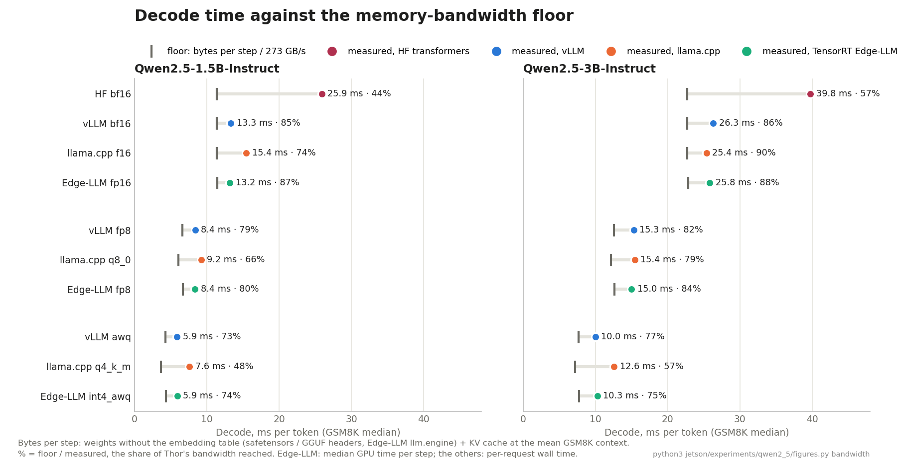
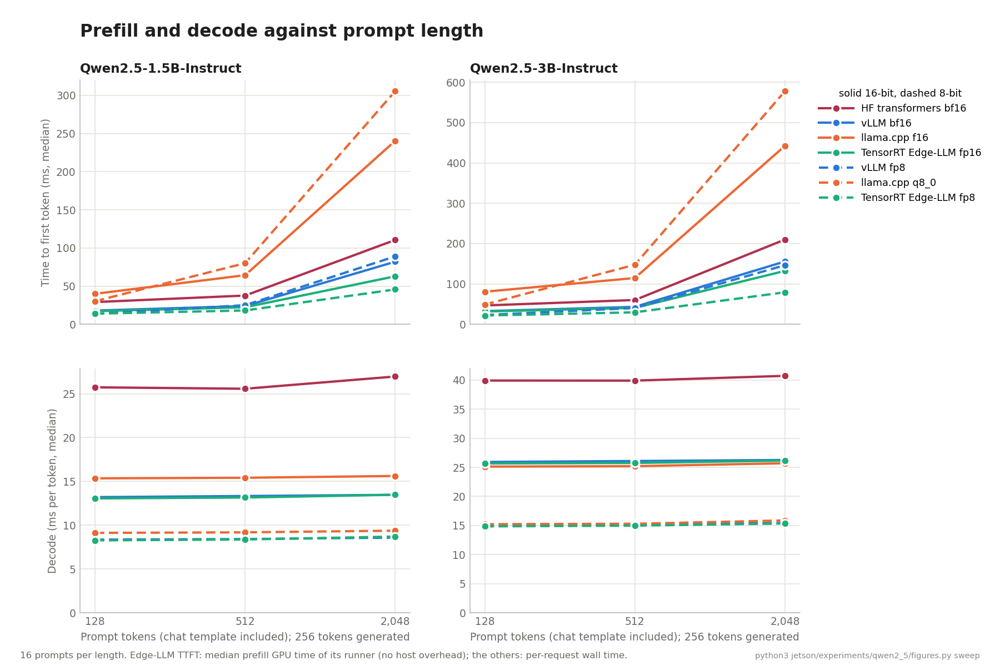
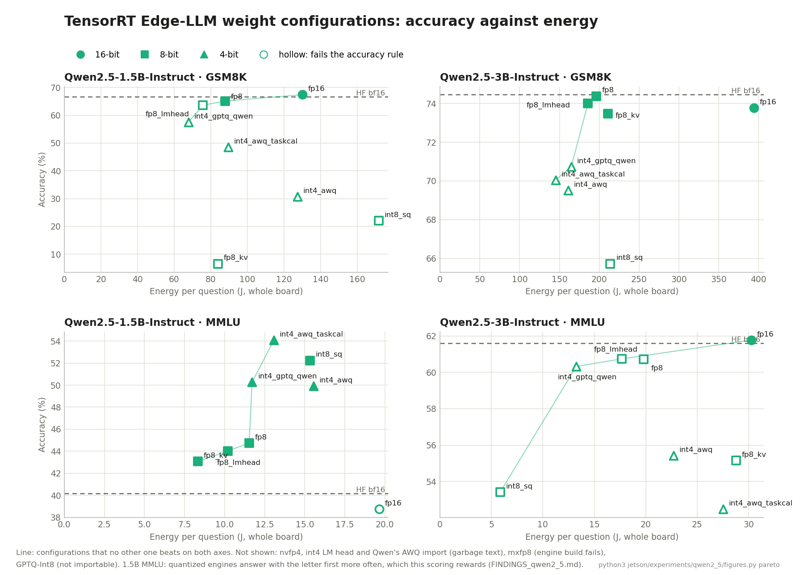

# Text-only Qwen2.5-Instruct on Jetson Thor: detailed results

Qwen2.5-1.5B / 3B-Instruct (text only) across HF transformers, vLLM, llama.cpp and TensorRT Edge-LLM, on GSM8K, MMLU and IFEval, plus a
controlled-length sweep and a study of Edge-LLM weight configurations. **Generated by `python3 jetson/experiments/qwen2_5/report.py`** from the
result files; edit the scripts, not this file.

- The conclusions in plain words: [FINDINGS_qwen2_5.md](FINDINGS_qwen2_5.md). Plan, decisions, problems: [NOTES_qwen2_5.md](NOTES_qwen2_5.md).
- Every run, including excluded ones: [SUMMARY.md](SUMMARY.md). How each metric is measured: [methodology](../../docs/methodology.md#text-only-models).

**For all tables:** power mode MAXN, batch 1, greedy, no repetition penalty, prefix caching off, nothing else on the GPU. Accuracy: GSM8K
flexible-extract, MMLU first A–D letter (all subjects), IFEval prompt-level strict. Δ vs HF = paired difference to HF bf16 on the same questions
± its standard error; ✗ = more than 2 SE below HF (the accuracy rule). Time / energy per question include each framework's own answer length.
TTFT p50: per-request median; Edge-LLM (*): median prefill GPU time from its runner profile, without host overhead.

## 1. Frameworks (Phase 1)

### Qwen2.5-3B-Instruct · GSM8K (5-shot, 1,319 questions)

| Configuration | Accuracy | Δ vs HF (± paired SE) | Same score | Time / question (s) | Energy / question (J) | Energy / output token (J) | TTFT p50 (ms) | Decode (ms/token) | Output tokens | Peak RAM (GB) | Power (W) | Run |
|---|---:|---:|---:|---:|---:|---:|---:|---:|---:|---:|---:|---|
| hf-bf16 | 74.5 | reference | - | 8.07 | 390.2 | 1.943 | 82 | 39.8 | 201 | 23.2 | 48.3 | [20261011](Qwen2.5-3B-Instruct/gsm8k_jetson/hf-bf16/20261011-055938) |
| vllm-bf16 | 74.1 | -0.3 ± 0.6 | 95% | 5.38 | 332.0 | 1.652 | 78 | 26.3 | 201 | 23.1 | 61.7 | [20261008](Qwen2.5-3B-Instruct/gsm8k_jetson/vllm-bf16/20261008-183331) |
| llamacpp-f16 | 74.1 | -0.4 ± 0.8 | 91% | 5.17 | 387.7 | 1.971 | 198 | 25.4 | 197 | 19.5 | 75.0 | [20261008](Qwen2.5-3B-Instruct/gsm8k_jetson/llamacpp-f16/20261008-223314) |
| trt_edgellm-fp16 | 73.8 | -0.7 ± 0.7 | 94% | 5.24 | 394.1 | 1.956 | 51* | 25.8 | 201 | 19.5 | 75.2 | [20261009](Qwen2.5-3B-Instruct/gsm8k_jetson/trt_edgellm-fp16/20261009-024221) |
| vllm-fp8 | 75.4 | +0.9 ± 0.9 | 89% | 3.39 | 206.0 | 0.954 | 65 | 15.3 | 216 | 22.6 | 60.7 | [20261008](Qwen2.5-3B-Instruct/gsm8k_jetson/vllm-fp8/20261008-203205) |
| llamacpp-q8_0 | 73.4 | -1.1 ± 0.9 | 90% | 3.20 | 236.2 | 1.221 | 219 | 15.4 | 194 | 19.4 | 73.7 | [20261009](Qwen2.5-3B-Instruct/gsm8k_jetson/llamacpp-q8_0/20261009-002712) |
| trt_edgellm-fp8 | 74.4 | -0.1 ± 0.9 | 89% | 3.03 | 196.2 | 0.984 | 37* | 15.0 | 199 | 19.5 | 64.7 | [20261009](Qwen2.5-3B-Instruct/gsm8k_jetson/trt_edgellm-fp8/20261009-043800) |
| vllm-awq | 72.5 | -2.0 ± 1.0 | 85% | 2.09 | 145.6 | 0.755 | 123 | 10.0 | 193 | 21.3 | 69.6 | [20261008](Qwen2.5-3B-Instruct/gsm8k_jetson/vllm-awq/20261008-214657) |
| llamacpp-q4_k_m | 72.6 | -1.8 ± 1.0 | 87% | 2.91 | 214.5 | 1.011 | 245 | 12.6 | 212 | 19.4 | 73.7 | [20261009](Qwen2.5-3B-Instruct/gsm8k_jetson/llamacpp-q4_k_m/20261009-013759) |
| trt_edgellm-int4_awq | 69.5 | -4.9 ± 1.1 ✗ | 83% | 2.28 | 160.7 | 0.761 | 105* | 10.3 | 211 | 19.6 | 70.4 | [20261009](Qwen2.5-3B-Instruct/gsm8k_jetson/trt_edgellm-int4_awq/20261009-054507) |
| trt_edgellm-fp8_kv | 73.5 | -1.0 ± 1.1 | 84% | 3.12 | 211.0 | 1.008 | 36* | 14.7 | 209 | 19.8 | 67.7 | [20261012](Qwen2.5-3B-Instruct/gsm8k_jetson/trt_edgellm-fp8_kv/20261012-024227) |
| trt_edgellm-fp8_lmhead | 74.0 | -0.5 ± 0.9 | 89% | 2.76 | 185.8 | 0.924 | 35* | 13.5 | 201 | 19.8 | 67.4 | [20261012](Qwen2.5-3B-Instruct/gsm8k_jetson/trt_edgellm-fp8_lmhead/20261012-035130) |
| trt_edgellm-int4_awq_taskcal | 70.1 | -4.4 ± 1.1 ✗ | 83% | 2.06 | 145.2 | 0.759 | 105* | 10.2 | 191 | 19.8 | 70.5 | [20261012](Qwen2.5-3B-Instruct/gsm8k_jetson/trt_edgellm-int4_awq_taskcal/20261012-045232) |
| trt_edgellm-int4_gptq_qwen | 70.7 | -3.7 ± 1.1 ✗ | 85% | 2.35 | 164.8 | 0.757 | 111* | 10.3 | 218 | 20.0 | 70.1 | [20261012](Qwen2.5-3B-Instruct/gsm8k_jetson/trt_edgellm-int4_gptq_qwen/20261012-053814) |
| trt_edgellm-int8_sq | 65.7 | -8.7 ± 1.3 ✗ | 79% | 3.35 | 213.9 | 0.994 | 38* | 15.4 | 215 | 19.9 | 63.9 | [20261011](Qwen2.5-3B-Instruct/gsm8k_jetson/trt_edgellm-int8_sq/20261011-235832) |

### Qwen2.5-3B-Instruct · MMLU (5-shot generative, 14,042 questions)

| Configuration | Accuracy | Δ vs HF (± paired SE) | Same score | Time / question (s) | Energy / question (J) | Energy / output token (J) | TTFT p50 (ms) | Decode (ms/token) | Output tokens | Peak RAM (GB) | Power (W) | Run |
|---|---:|---:|---:|---:|---:|---:|---:|---:|---:|---:|---:|---|
| hf-bf16 | 61.6 | reference | - | 0.58 | 31.6 | 2.414 | 71 | 39.9 | 13 | 23.5 | 54.0 | [20261011](Qwen2.5-3B-Instruct/mmlu_jetson/hf-bf16/20261011-085737) |
| vllm-bf16 | 61.7 | +0.1 ± 0.1 | 99% | 0.41 | 27.1 | 2.067 | 58 | 26.2 | 13 | 23.8 | 66.5 | [20261009](Qwen2.5-3B-Instruct/mmlu_jetson/vllm-bf16/20261009-085718) |
| llamacpp-f16 | 61.9 | +0.3 ± 0.2 | 95% | 0.37 | 27.4 | 3.732 | 179 | 26.2 | 7 | 21.5 | 73.4 | [20261009](Qwen2.5-3B-Instruct/mmlu_jetson/llamacpp-f16/20261009-122025) |
| trt_edgellm-fp16 | 61.8 | +0.2 ± 0.1 | 99% | 0.38 | 30.3 | 2.371 | 46* | 25.9 | 13 | 21.5 | 80.1 | [20261009](Qwen2.5-3B-Instruct/mmlu_jetson/trt_edgellm-fp16/20261009-163348) |
| vllm-fp8 | 61.8 | +0.2 ± 0.2 | 94% | 0.28 | 18.4 | 1.327 | 49 | 15.4 | 14 | 23.3 | 65.4 | [20261009](Qwen2.5-3B-Instruct/mmlu_jetson/vllm-fp8/20261009-103256) |
| llamacpp-q8_0 | 61.8 | +0.2 ± 0.2 | 94% | 0.33 | 21.4 | 3.199 | 175 | 16.3 | 7 | 21.2 | 65.4 | [20261009](Qwen2.5-3B-Instruct/mmlu_jetson/llamacpp-q8_0/20261009-134803) |
| trt_edgellm-fp8 | 60.7 | -0.9 ± 0.2 ✗ | 92% | 0.29 | 19.8 | 1.197 | 33* | 15.1 | 17 | 21.5 | 68.7 | [20261009](Qwen2.5-3B-Instruct/mmlu_jetson/trt_edgellm-fp8/20261009-180300) |
| vllm-awq | 58.7 | -2.9 ± 0.3 ✗ | 86% | 0.18 | 14.7 | 3.232 | 92 | 10.2 | 5 | 23.1 | 83.8 | [20261009](Qwen2.5-3B-Instruct/mmlu_jetson/vllm-awq/20261009-113858) |
| llamacpp-q4_k_m | 58.6 | -3.0 ± 0.3 ✗ | 86% | 0.38 | 23.8 | 2.393 | 193 | 13.1 | 10 | 21.1 | 63.1 | [20261009](Qwen2.5-3B-Instruct/mmlu_jetson/llamacpp-q4_k_m/20261009-150500) |
| trt_edgellm-int4_awq | 55.4 | -6.2 ± 0.4 ✗ | 79% | 0.29 | 22.7 | 1.316 | 86* | 10.3 | 17 | 21.5 | 78.0 | [20261009](Qwen2.5-3B-Instruct/mmlu_jetson/trt_edgellm-int4_awq/20261009-191117) |
| trt_edgellm-fp8_kv | 55.2 | -6.4 ± 0.4 ✗ | 82% | 0.41 | 28.8 | 1.134 | 33* | 14.7 | 25 | 20.2 | 69.8 | [20261012](Qwen2.5-3B-Instruct/mmlu_jetson/trt_edgellm-fp8_kv/20261012-063036) |
| trt_edgellm-fp8_lmhead | 60.7 | -0.9 ± 0.2 ✗ | 92% | 0.25 | 17.7 | 1.145 | 32* | 13.5 | 15 | 20.1 | 71.3 | [20261012](Qwen2.5-3B-Instruct/mmlu_jetson/trt_edgellm-fp8_lmhead/20261012-080755) |
| trt_edgellm-int4_awq_taskcal | 52.5 | -9.1 ± 0.4 ✗ | 80% | 0.36 | 27.5 | 1.130 | 86* | 10.1 | 24 | 20.6 | 76.1 | [20261012](Qwen2.5-3B-Instruct/mmlu_jetson/trt_edgellm-int4_awq_taskcal/20261012-090642) |
| trt_edgellm-int4_gptq_qwen | 60.3 | -1.3 ± 0.3 ✗ | 86% | 0.16 | 13.3 | 3.597 | 91* | 10.3 | 4 | 20.5 | 84.2 | [20261012](Qwen2.5-3B-Instruct/mmlu_jetson/trt_edgellm-int4_gptq_qwen/20261012-103205) |
| trt_edgellm-int8_sq | 53.4 | -8.2 ± 0.4 ✗ | 76% | 0.08 | 5.9 | 1.951 | 34* | 15.3 | 3 | 20.1 | 69.0 | [20261012](Qwen2.5-3B-Instruct/mmlu_jetson/trt_edgellm-int8_sq/20261012-011245) |

### Qwen2.5-3B-Instruct · IFEval (541 prompts)

| Configuration | Accuracy | Δ vs HF (± paired SE) | Same score | Time / question (s) | Energy / question (J) | Energy / output token (J) | TTFT p50 (ms) | Decode (ms/token) | Output tokens | Peak RAM (GB) | Power (W) | Run |
|---|---:|---:|---:|---:|---:|---:|---:|---:|---:|---:|---:|---|
| hf-bf16 | 60.3 | reference | - | 13.04 | 614.7 | 1.864 | 44 | 39.3 | 330 | 23.2 | 47.1 | [20261011](Qwen2.5-3B-Instruct/ifeval/hf-bf16/20261011-111500) |
| vllm-bf16 | 59.5 | -0.7 ± 1.2 | 92% | 8.61 | 516.4 | 1.583 | 54 | 26.0 | 326 | 25.5 | 60.0 | [20261009](Qwen2.5-3B-Instruct/ifeval/vllm-bf16/20261009-220116) |
| llamacpp-f16 | 60.3 | +0.0 ± 1.6 | 87% | 8.10 | 604.3 | 1.894 | 75 | 25.2 | 319 | 21.2 | 74.6 | [20261010](Qwen2.5-3B-Instruct/ifeval/llamacpp-f16/20261010-003826) |
| trt_edgellm-fp16 | 59.3 | -0.9 ± 1.2 | 92% | 8.34 | 622.4 | 1.926 | 31* | 25.7 | 323 | 21.1 | 74.6 | [20261010](Qwen2.5-3B-Instruct/ifeval/trt_edgellm-fp16/20261010-031531) |
| vllm-fp8 | 56.9 | -3.3 ± 1.6 ✗ | 86% | 5.40 | 315.5 | 0.906 | 32 | 15.2 | 348 | 23.5 | 58.4 | [20261009](Qwen2.5-3B-Instruct/ifeval/vllm-fp8/20261009-231914) |
| llamacpp-q8_0 | 58.8 | -1.5 ± 1.6 | 87% | 4.80 | 355.7 | 1.142 | 39 | 15.2 | 312 | 21.0 | 74.1 | [20261010](Qwen2.5-3B-Instruct/ifeval/llamacpp-q8_0/20261010-015148) |
| trt_edgellm-fp8 | 56.4 | -3.9 ± 1.8 ✗ | 83% | 5.16 | 333.8 | 0.974 | 22* | 15.0 | 343 | 21.2 | 64.6 | [20261010](Qwen2.5-3B-Instruct/ifeval/trt_edgellm-fp8/20261010-043108) |
| vllm-awq | 58.6 | -1.7 ± 1.8 | 82% | 3.32 | 221.4 | 0.691 | 28 | 9.9 | 320 | 23.1 | 66.8 | [20261010](Qwen2.5-3B-Instruct/ifeval/vllm-awq/20261010-000815) |
| llamacpp-q4_k_m | 59.3 | -0.9 ± 1.8 | 83% | 4.41 | 328.6 | 0.932 | 39 | 12.4 | 353 | 21.1 | 74.5 | [20261010](Qwen2.5-3B-Instruct/ifeval/llamacpp-q4_k_m/20261010-023525) |
| trt_edgellm-int4_awq | 58.0 | -2.2 ± 2.0 | 78% | 3.63 | 254.2 | 0.717 | 25* | 10.2 | 354 | 21.2 | 70.0 | [20261010](Qwen2.5-3B-Instruct/ifeval/trt_edgellm-int4_awq/20261010-051805) |
| trt_edgellm-int8_sq | 50.1 | -10.2 ± 2.1 ✗ | 75% | 7.57 | 482.8 | 0.982 | 22* | 15.3 | 491 | 19.8 | 63.8 | [20261012](Qwen2.5-3B-Instruct/ifeval/trt_edgellm-int8_sq/20261012-013335) |

### Qwen2.5-1.5B-Instruct · GSM8K (5-shot, 1,319 questions)

| Configuration | Accuracy | Δ vs HF (± paired SE) | Same score | Time / question (s) | Energy / question (J) | Energy / output token (J) | TTFT p50 (ms) | Decode (ms/token) | Output tokens | Peak RAM (GB) | Power (W) | Run |
|---|---:|---:|---:|---:|---:|---:|---:|---:|---:|---:|---:|---|
| hf-bf16 | 66.7 | reference | - | 3.90 | 169.7 | 1.132 | 44 | 25.9 | 150 | 21.8 | 43.5 | [20261011](Qwen2.5-1.5B-Instruct/gsm8k_jetson/hf-bf16/20261011-131302) |
| vllm-bf16 | 66.7 | +0.0 ± 0.7 | 94% | 2.08 | 126.9 | 0.842 | 36 | 13.3 | 151 | 21.2 | 61.1 | [20261010](Qwen2.5-1.5B-Instruct/gsm8k_jetson/vllm-bf16/20261010-073925) |
| llamacpp-f16 | 64.3 | -2.4 ± 1.0 ✗ | 86% | 2.41 | 167.8 | 1.119 | 102 | 15.4 | 150 | 19.3 | 69.6 | [20261010](Qwen2.5-1.5B-Instruct/gsm8k_jetson/llamacpp-f16/20261010-091943) |
| trt_edgellm-fp16 | 67.4 | +0.7 ± 0.8 | 92% | 2.04 | 130.0 | 0.854 | 28* | 13.2 | 152 | 19.0 | 63.9 | [20261010](Qwen2.5-1.5B-Instruct/gsm8k_jetson/trt_edgellm-fp16/20261010-111357) |
| vllm-fp8 | 66.3 | -0.4 ± 1.0 | 86% | 1.36 | 79.0 | 0.520 | 36 | 8.4 | 152 | 21.8 | 58.1 | [20261010](Qwen2.5-1.5B-Instruct/gsm8k_jetson/vllm-fp8/20261010-082521) |
| llamacpp-q8_0 | 64.5 | -2.2 ± 1.1 ✗ | 85% | 1.51 | 102.4 | 0.679 | 118 | 9.2 | 151 | 18.9 | 68.0 | [20261010](Qwen2.5-1.5B-Instruct/gsm8k_jetson/llamacpp-q8_0/20261010-101305) |
| trt_edgellm-fp8 | 65.1 | -1.6 ± 1.0 | 86% | 1.30 | 87.8 | 0.577 | 21* | 8.4 | 152 | 19.0 | 67.5 | [20261010](Qwen2.5-1.5B-Instruct/gsm8k_jetson/trt_edgellm-fp8/20261010-115908) |
| vllm-awq | 58.7 | -8.0 ± 1.3 ✗ | 76% | 1.09 | 69.6 | 0.423 | 64 | 5.9 | 165 | 21.2 | 64.1 | [20261010](Qwen2.5-1.5B-Instruct/gsm8k_jetson/vllm-awq/20261010-085532) |
| llamacpp-q4_k_m | 60.6 | -6.1 ± 1.2 ✗ | 79% | 1.23 | 80.0 | 0.552 | 129 | 7.6 | 145 | 18.9 | 64.9 | [20261010](Qwen2.5-1.5B-Instruct/gsm8k_jetson/llamacpp-q4_k_m/20261010-104631) |
| trt_edgellm-int4_awq | 30.8 | -35.9 ± 1.6 ✗ | 55% | 1.82 | 127.3 | 0.429 | 54* | 5.9 | 297 | 19.0 | 69.8 | [20261010](Qwen2.5-1.5B-Instruct/gsm8k_jetson/trt_edgellm-int4_awq/20261010-122809) |
| trt_edgellm-fp8_kv | 6.6 | -60.1 ± 1.4 ✗ | 37% | 1.26 | 83.9 | 0.571 | 21* | 8.4 | 147 | 19.8 | 66.8 | [20261012](Qwen2.5-1.5B-Instruct/gsm8k_jetson/trt_edgellm-fp8_kv/20261012-135808) |
| trt_edgellm-fp8_lmhead | 63.6 | -3.1 ± 1.1 ✗ | 84% | 1.19 | 75.7 | 0.485 | 21* | 7.5 | 156 | 19.9 | 63.5 | [20261012](Qwen2.5-1.5B-Instruct/gsm8k_jetson/trt_edgellm-fp8_lmhead/20261012-142609) |
| trt_edgellm-int4_awq_taskcal | 48.6 | -18.1 ± 1.5 ✗ | 69% | 1.28 | 89.4 | 0.432 | 54* | 5.9 | 207 | 19.8 | 69.7 | [20261012](Qwen2.5-1.5B-Instruct/gsm8k_jetson/trt_edgellm-int4_awq_taskcal/20261012-145250) |
| trt_edgellm-int4_gptq_qwen | 57.5 | -9.2 ± 1.3 ✗ | 76% | 0.98 | 67.8 | 0.443 | 58* | 5.9 | 153 | 20.2 | 69.5 | [20261012](Qwen2.5-1.5B-Instruct/gsm8k_jetson/trt_edgellm-int4_gptq_qwen/20261012-152131) |
| trt_edgellm-int8_sq | 22.1 | -44.7 ± 1.5 ✗ | 50% | 2.73 | 171.6 | 0.550 | 22* | 8.7 | 312 | 20.4 | 62.8 | [20261012](Qwen2.5-1.5B-Instruct/gsm8k_jetson/trt_edgellm-int8_sq/20261012-110958) |

### Qwen2.5-1.5B-Instruct · MMLU (5-shot generative, 14,042 questions)

| Configuration | Accuracy | Δ vs HF (± paired SE) | Same score | Time / question (s) | Energy / question (J) | Energy / output token (J) | TTFT p50 (ms) | Decode (ms/token) | Output tokens | Peak RAM (GB) | Power (W) | Run |
|---|---:|---:|---:|---:|---:|---:|---:|---:|---:|---:|---:|---|
| hf-bf16 | 40.2 | reference | - | 0.57 | 26.7 | 1.297 | 39 | 25.6 | 21 | 20.6 | 47.0 | [20261010](Qwen2.5-1.5B-Instruct/mmlu_jetson/hf-bf16/20261010-130850) |
| vllm-bf16 | 39.6 | -0.6 ± 0.1 ✗ | 97% | 0.31 | 20.2 | 1.000 | 27 | 13.3 | 20 | 21.8 | 65.3 | [20261010](Qwen2.5-1.5B-Instruct/mmlu_jetson/vllm-bf16/20261010-152159) |
| llamacpp-f16 | 37.3 | -2.9 ± 0.3 ✗ | 88% | 0.37 | 25.7 | 1.507 | 91 | 15.6 | 17 | 21.1 | 69.4 | [20261010](Qwen2.5-1.5B-Instruct/mmlu_jetson/llamacpp-f16/20261010-175144) |
| trt_edgellm-fp16 | 38.8 | -1.4 ± 0.2 ✗ | 95% | 0.29 | 19.6 | 0.993 | 25* | 13.2 | 20 | 21.1 | 66.8 | [20261010](Qwen2.5-1.5B-Instruct/mmlu_jetson/trt_edgellm-fp16/20261010-212917) |
| vllm-fp8 | 39.4 | -0.7 ± 0.3 ✗ | 87% | 0.20 | 12.6 | 0.676 | 28 | 8.4 | 19 | 22.8 | 61.7 | [20261010](Qwen2.5-1.5B-Instruct/mmlu_jetson/vllm-fp8/20261010-163452) |
| llamacpp-q8_0 | 38.1 | -2.1 ± 0.3 ✗ | 89% | 0.28 | 18.0 | 1.087 | 96 | 9.5 | 17 | 20.9 | 63.6 | [20261010](Qwen2.5-1.5B-Instruct/mmlu_jetson/llamacpp-q8_0/20261010-191847) |
| trt_edgellm-fp8 | 44.7 | +4.6 ± 0.3 | 86% | 0.17 | 11.5 | 0.686 | 19* | 8.4 | 17 | 21.2 | 67.1 | [20261010](Qwen2.5-1.5B-Instruct/mmlu_jetson/trt_edgellm-fp8/20261010-223849) |
| vllm-awq | 29.1 | -11.1 ± 0.4 ✗ | 76% | 0.12 | 8.8 | 1.132 | 49 | 6.0 | 8 | 22.7 | 71.7 | [20261010](Qwen2.5-1.5B-Instruct/mmlu_jetson/vllm-awq/20261010-172248) |
| llamacpp-q4_k_m | 38.5 | -1.7 ± 0.3 ✗ | 83% | 0.27 | 16.4 | 0.963 | 103 | 7.8 | 17 | 20.8 | 60.4 | [20261010](Qwen2.5-1.5B-Instruct/mmlu_jetson/llamacpp-q4_k_m/20261010-202515) |
| trt_edgellm-int4_awq | 49.9 | +9.7 ± 0.5 | 68% | 0.21 | 15.5 | 0.617 | 44* | 5.9 | 25 | 21.1 | 72.6 | [20261010](Qwen2.5-1.5B-Instruct/mmlu_jetson/trt_edgellm-int4_awq/20261010-231946) |
| trt_edgellm-fp8_kv | 43.1 | +2.9 ± 0.5 | 66% | 0.12 | 8.3 | 0.736 | 19* | 8.4 | 11 | 20.7 | 66.8 | [20261012](Qwen2.5-1.5B-Instruct/mmlu_jetson/trt_edgellm-fp8_kv/20261012-154343) |
| trt_edgellm-fp8_lmhead | 44.0 | +3.9 ± 0.3 | 85% | 0.16 | 10.2 | 0.591 | 18* | 7.5 | 17 | 20.6 | 64.2 | [20261012](Qwen2.5-1.5B-Instruct/mmlu_jetson/trt_edgellm-fp8_lmhead/20261012-161345) |
| trt_edgellm-int4_awq_taskcal | 54.1 | +13.9 ± 0.5 | 66% | 0.18 | 13.1 | 0.681 | 44* | 5.9 | 19 | 20.4 | 73.1 | [20261012](Qwen2.5-1.5B-Instruct/mmlu_jetson/trt_edgellm-int4_awq_taskcal/20261012-165141) |
| trt_edgellm-int4_gptq_qwen | 50.3 | +10.1 ± 0.4 | 74% | 0.16 | 11.7 | 0.776 | 47* | 5.9 | 15 | 20.1 | 73.7 | [20261012](Qwen2.5-1.5B-Instruct/mmlu_jetson/trt_edgellm-int4_gptq_qwen/20261012-173418) |
| trt_edgellm-int8_sq | 52.2 | +12.1 ± 0.5 | 65% | 0.25 | 15.3 | 0.610 | 19* | 8.6 | 25 | 20.4 | 62.2 | [20261012](Qwen2.5-1.5B-Instruct/mmlu_jetson/trt_edgellm-int8_sq/20261012-121046) |

### Qwen2.5-1.5B-Instruct · IFEval (541 prompts)

| Configuration | Accuracy | Δ vs HF (± paired SE) | Same score | Time / question (s) | Energy / question (J) | Energy / output token (J) | TTFT p50 (ms) | Decode (ms/token) | Output tokens | Peak RAM (GB) | Power (W) | Run |
|---|---:|---:|---:|---:|---:|---:|---:|---:|---:|---:|---:|---|
| hf-bf16 | 41.6 | reference | - | 8.63 | 363.1 | 1.098 | 29 | 26.3 | 331 | 22.4 | 42.1 | [20261011](Qwen2.5-1.5B-Instruct/ifeval/hf-bf16/20261011-001050) |
| vllm-bf16 | 40.5 | -1.1 ± 1.0 | 94% | 4.37 | 259.7 | 0.806 | 28 | 13.3 | 322 | 23.3 | 59.5 | [20261011](Qwen2.5-1.5B-Instruct/ifeval/vllm-bf16/20261011-012858) |
| llamacpp-f16 | 41.4 | -0.2 ± 1.5 | 87% | 4.89 | 337.8 | 1.069 | 38 | 15.3 | 316 | 20.4 | 69.1 | [20261011](Qwen2.5-1.5B-Instruct/ifeval/llamacpp-f16/20261011-025741) |
| trt_edgellm-fp16 | 41.0 | -0.6 ± 1.2 | 92% | 4.32 | 271.2 | 0.828 | 17* | 13.1 | 328 | 20.3 | 62.7 | [20261011](Qwen2.5-1.5B-Instruct/ifeval/trt_edgellm-fp16/20261011-043149) |
| vllm-fp8 | 41.4 | -0.2 ± 1.4 | 89% | 2.98 | 169.5 | 0.489 | 18 | 8.3 | 346 | 22.6 | 56.9 | [20261011](Qwen2.5-1.5B-Instruct/ifeval/vllm-fp8/20261011-020839) |
| llamacpp-q8_0 | 41.8 | +0.2 ± 1.5 | 87% | 2.95 | 200.6 | 0.625 | 25 | 9.1 | 321 | 20.3 | 67.9 | [20261011](Qwen2.5-1.5B-Instruct/ifeval/llamacpp-q8_0/20261011-034202) |
| trt_edgellm-fp8 | 41.8 | +0.2 ± 1.5 | 88% | 2.74 | 180.2 | 0.552 | 14* | 8.3 | 326 | 20.4 | 65.9 | [20261011](Qwen2.5-1.5B-Instruct/ifeval/trt_edgellm-fp8/20261011-051110) |
| vllm-awq | 37.2 | -4.4 ± 1.7 ✗ | 84% | 2.39 | 150.0 | 0.385 | 16 | 5.8 | 389 | 22.2 | 62.7 | [20261011](Qwen2.5-1.5B-Instruct/ifeval/vllm-awq/20261011-023550) |
| llamacpp-q4_k_m | 37.7 | -3.9 ± 1.9 ✗ | 81% | 2.50 | 161.7 | 0.491 | 24 | 7.5 | 329 | 20.2 | 64.6 | [20261011](Qwen2.5-1.5B-Instruct/ifeval/llamacpp-q4_k_m/20261011-040858) |
| trt_edgellm-int4_awq | 36.8 | -4.8 ± 1.9 ✗ | 80% | 2.51 | 172.8 | 0.405 | 15* | 5.8 | 427 | 20.3 | 68.7 | [20261011](Qwen2.5-1.5B-Instruct/ifeval/trt_edgellm-int4_awq/20261011-053611) |
| trt_edgellm-int8_sq | 34.6 | -7.0 ± 2.2 ✗ | 74% | 5.33 | 332.7 | 0.543 | 14* | 8.6 | 613 | 19.8 | 62.5 | [20261012](Qwen2.5-1.5B-Instruct/ifeval/trt_edgellm-int8_sq/20261012-130925) |

## 2. The Q1 rule

Rule fixed before Phase 1 ([NOTES_qwen2_5.md](NOTES_qwen2_5.md#plan-written-2026-10-08-before-building)); the verdict is in the notes.

Per size, task and bit width: frameworks that pass the accuracy rule, the best value of each metric and who is best or tied (within 5%; 15% when the two runs are from different days).

| Size | Task | Bits | Metric | Best | Best or tied | Edge-LLM |
|---|---|---:|---|---|---|---|
| 3b | gsm8k_jetson | 16 | energy / question | vllm-bf16 (332) | vllm-bf16 | – |
| 3b | gsm8k_jetson | 16 | time / question | llamacpp-f16 (5.17) | vllm-bf16, llamacpp-f16, trt_edgellm-fp16 | ✓ |
| 3b | gsm8k_jetson | 16 | TTFT median | trt_edgellm-fp16 (50.7) | trt_edgellm-fp16 | ✓ |
| 3b | gsm8k_jetson | 16 | decode ms/token median | llamacpp-f16 (25.4) | vllm-bf16, llamacpp-f16, trt_edgellm-fp16 | ✓ |
| 3b | gsm8k_jetson | 8 | energy / question | trt_edgellm-fp8 (196) | vllm-fp8, trt_edgellm-fp8 | ✓ |
| 3b | gsm8k_jetson | 8 | time / question | trt_edgellm-fp8 (3.03) | vllm-fp8, trt_edgellm-fp8 | ✓ |
| 3b | gsm8k_jetson | 8 | TTFT median | trt_edgellm-fp8 (36.8) | trt_edgellm-fp8 | ✓ |
| 3b | gsm8k_jetson | 8 | decode ms/token median | trt_edgellm-fp8 (15) | vllm-fp8, llamacpp-q8_0, trt_edgellm-fp8 | ✓ |
| 3b | gsm8k_jetson | 4 | energy / question | vllm-awq (146) | vllm-awq | – |
| 3b | gsm8k_jetson | 4 | time / question | vllm-awq (2.09) | vllm-awq | – |
| 3b | gsm8k_jetson | 4 | TTFT median | vllm-awq (123) | vllm-awq | – |
| 3b | gsm8k_jetson | 4 | decode ms/token median | vllm-awq (9.98) | vllm-awq | – |
| 3b | mmlu_jetson | 16 | energy / question | vllm-bf16 (27.1) | vllm-bf16, llamacpp-f16 | – |
| 3b | mmlu_jetson | 16 | time / question | llamacpp-f16 (0.373) | llamacpp-f16, trt_edgellm-fp16 | ✓ |
| 3b | mmlu_jetson | 16 | TTFT median | trt_edgellm-fp16 (46.4) | trt_edgellm-fp16 | ✓ |
| 3b | mmlu_jetson | 16 | decode ms/token median | trt_edgellm-fp16 (25.9) | vllm-bf16, llamacpp-f16, trt_edgellm-fp16 | ✓ |
| 3b | mmlu_jetson | 8 | energy / question | vllm-fp8 (18.4) | vllm-fp8 | – |
| 3b | mmlu_jetson | 8 | time / question | vllm-fp8 (0.281) | vllm-fp8 | – |
| 3b | mmlu_jetson | 8 | TTFT median | vllm-fp8 (49.1) | vllm-fp8 | – |
| 3b | mmlu_jetson | 8 | decode ms/token median | vllm-fp8 (15.4) | vllm-fp8 | – |
| 3b | ifeval | 16 | energy / question | vllm-bf16 (516) | vllm-bf16 | – |
| 3b | ifeval | 16 | time / question | llamacpp-f16 (8.1) | vllm-bf16, llamacpp-f16, trt_edgellm-fp16 | ✓ |
| 3b | ifeval | 16 | TTFT median | trt_edgellm-fp16 (31.2) | trt_edgellm-fp16 | ✓ |
| 3b | ifeval | 16 | decode ms/token median | llamacpp-f16 (25.2) | vllm-bf16, llamacpp-f16, trt_edgellm-fp16 | ✓ |
| 3b | ifeval | 8 | energy / question | llamacpp-q8_0 (356) | llamacpp-q8_0 | – |
| 3b | ifeval | 8 | time / question | llamacpp-q8_0 (4.8) | llamacpp-q8_0 | – |
| 3b | ifeval | 8 | TTFT median | llamacpp-q8_0 (39.1) | llamacpp-q8_0 | – |
| 3b | ifeval | 8 | decode ms/token median | llamacpp-q8_0 (15.2) | llamacpp-q8_0 | – |
| 3b | ifeval | 4 | energy / question | vllm-awq (221) | vllm-awq | – |
| 3b | ifeval | 4 | time / question | vllm-awq (3.32) | vllm-awq | – |
| 3b | ifeval | 4 | TTFT median | trt_edgellm-int4_awq (25.3) | trt_edgellm-int4_awq | ✓ |
| 3b | ifeval | 4 | decode ms/token median | vllm-awq (9.91) | vllm-awq, trt_edgellm-int4_awq | ✓ |
| 1.5b | gsm8k_jetson | 16 | energy / question | vllm-bf16 (127) | vllm-bf16, trt_edgellm-fp16 | ✓ |
| 1.5b | gsm8k_jetson | 16 | time / question | trt_edgellm-fp16 (2.04) | vllm-bf16, trt_edgellm-fp16 | ✓ |
| 1.5b | gsm8k_jetson | 16 | TTFT median | trt_edgellm-fp16 (27.9) | trt_edgellm-fp16 | ✓ |
| 1.5b | gsm8k_jetson | 16 | decode ms/token median | trt_edgellm-fp16 (13.2) | vllm-bf16, trt_edgellm-fp16 | ✓ |
| 1.5b | gsm8k_jetson | 8 | energy / question | vllm-fp8 (79) | vllm-fp8 | – |
| 1.5b | gsm8k_jetson | 8 | time / question | trt_edgellm-fp8 (1.3) | vllm-fp8, trt_edgellm-fp8 | ✓ |
| 1.5b | gsm8k_jetson | 8 | TTFT median | trt_edgellm-fp8 (21.4) | trt_edgellm-fp8 | ✓ |
| 1.5b | gsm8k_jetson | 8 | decode ms/token median | trt_edgellm-fp8 (8.37) | vllm-fp8, trt_edgellm-fp8 | ✓ |
| 1.5b | mmlu_jetson | 16 | energy / question | hf-bf16 (26.7) | hf-bf16 | – |
| 1.5b | mmlu_jetson | 16 | time / question | hf-bf16 (0.568) | hf-bf16 | – |
| 1.5b | mmlu_jetson | 16 | TTFT median | hf-bf16 (39.4) | hf-bf16 | – |
| 1.5b | mmlu_jetson | 16 | decode ms/token median | hf-bf16 (25.6) | hf-bf16 | – |
| 1.5b | mmlu_jetson | 8 | energy / question | trt_edgellm-fp8 (11.5) | trt_edgellm-fp8 | ✓ |
| 1.5b | mmlu_jetson | 8 | time / question | trt_edgellm-fp8 (0.172) | trt_edgellm-fp8 | ✓ |
| 1.5b | mmlu_jetson | 8 | TTFT median | trt_edgellm-fp8 (18.8) | trt_edgellm-fp8 | ✓ |
| 1.5b | mmlu_jetson | 8 | decode ms/token median | trt_edgellm-fp8 (8.44) | trt_edgellm-fp8 | ✓ |
| 1.5b | mmlu_jetson | 4 | energy / question | trt_edgellm-int4_awq (15.5) | trt_edgellm-int4_awq | ✓ |
| 1.5b | mmlu_jetson | 4 | time / question | trt_edgellm-int4_awq (0.214) | trt_edgellm-int4_awq | ✓ |
| 1.5b | mmlu_jetson | 4 | TTFT median | trt_edgellm-int4_awq (43.9) | trt_edgellm-int4_awq | ✓ |
| 1.5b | mmlu_jetson | 4 | decode ms/token median | trt_edgellm-int4_awq (5.85) | trt_edgellm-int4_awq | ✓ |
| 1.5b | ifeval | 16 | energy / question | vllm-bf16 (260) | vllm-bf16, trt_edgellm-fp16 | ✓ |
| 1.5b | ifeval | 16 | time / question | trt_edgellm-fp16 (4.32) | vllm-bf16, trt_edgellm-fp16 | ✓ |
| 1.5b | ifeval | 16 | TTFT median | trt_edgellm-fp16 (17) | trt_edgellm-fp16 | ✓ |
| 1.5b | ifeval | 16 | decode ms/token median | trt_edgellm-fp16 (13.1) | vllm-bf16, trt_edgellm-fp16 | ✓ |
| 1.5b | ifeval | 8 | energy / question | vllm-fp8 (169) | vllm-fp8 | – |
| 1.5b | ifeval | 8 | time / question | trt_edgellm-fp8 (2.74) | trt_edgellm-fp8 | ✓ |
| 1.5b | ifeval | 8 | TTFT median | trt_edgellm-fp8 (13.9) | trt_edgellm-fp8 | ✓ |
| 1.5b | ifeval | 8 | decode ms/token median | trt_edgellm-fp8 (8.3) | vllm-fp8, trt_edgellm-fp8 | ✓ |

Edge-LLM best or tied on ≥ 3 of 4 metrics, per size and task (bit width: metrics won):

- 3b gsm8k_jetson: 16-bit 3/4, 8-bit 4/4 → wins
- 3b mmlu_jetson: 16-bit 3/4 → wins
- 3b ifeval: 16-bit 3/4, 4-bit 2/4
- **3b: Edge-LLM wins 2 of 3 tasks**
- 1.5b gsm8k_jetson: 16-bit 4/4, 8-bit 3/4 → wins
- 1.5b mmlu_jetson: 8-bit 4/4, 4-bit 4/4 → wins
- 1.5b ifeval: 16-bit 4/4, 8-bit 3/4 → wins
- **1.5b: Edge-LLM wins 3 of 3 tasks**
- Edge-LLM fails the accuracy rule where another framework passes: 3b gsm8k_jetson trt_edgellm-int4_awq, 3b mmlu_jetson trt_edgellm-fp8, 3b ifeval trt_edgellm-fp8, 1.5b mmlu_jetson trt_edgellm-fp16

**Q1 rule: not a win (split or negative), see the rows above.**

**Sensitivity check** (accuracy rule passes Δ ≥ −max(2 SE, 1 point); NOTES decision 16):

Edge-LLM best or tied on ≥ 3 of 4 metrics, per size and task (bit width: metrics won):

- 3b gsm8k_jetson: 16-bit 3/4, 8-bit 4/4 → wins
- 3b mmlu_jetson: 16-bit 3/4, 8-bit 3/4 → wins
- 3b ifeval: 16-bit 3/4, 4-bit 2/4
- **3b: Edge-LLM wins 2 of 3 tasks**
- 1.5b gsm8k_jetson: 16-bit 4/4, 8-bit 3/4 → wins
- 1.5b mmlu_jetson: 8-bit 4/4, 4-bit 4/4 → wins
- 1.5b ifeval: 16-bit 4/4, 8-bit 3/4 → wins
- **1.5b: Edge-LLM wins 3 of 3 tasks**
- Edge-LLM fails the accuracy rule where another framework passes: 3b gsm8k_jetson trt_edgellm-int4_awq, 3b ifeval trt_edgellm-fp8, 1.5b mmlu_jetson trt_edgellm-fp16

**Q1 rule: not a win (split or negative), see the rows above.**

## 3. Repeats on a different day

| Size | Task | Configuration | Runs (dates) | Accuracy | Time / question | Energy / question | TTFT p50 | Decode ms/token |
|---|---|---|---|---|---|---|---|---|
| 1.5b | gsm8k_jetson | vllm-fp8 | 20261010 / 20261011 | 66.3 → 66.3 | 1.36 → 1.35 (-1%) | 79.0 → 78.9 (-0%) | 36 → 35 (-1%) | 8.4 → 8.4 (+0%) |
| 1.5b | gsm8k_jetson | llamacpp-q8_0 | 20261010 / 20261011 | 64.5 → 64.5 | 1.51 → 1.51 (+0%) | 102.4 → 102.6 (+0%) | 118 → 118 (+0%) | 9.2 → 9.2 (+0%) |
| 1.5b | gsm8k_jetson | trt_edgellm-fp8 | 20261010 / 20261011 | 65.1 → 65.1 | 1.30 → 1.31 (+1%) | 87.8 → 87.7 (-0%) | 21 → 22 (+1%) | 8.4 → 8.4 (+1%) |
| 1.5b | mmlu_jetson | hf-bf16 | 20261010 / 20261011 | 40.2 → 40.2 | 0.57 → 0.56 (-1%) | 26.7 → 26.2 (-2%) | 39 → 39 (-0%) | 25.6 → 25.2 (-1%) |

## 4. Decode against the memory-bandwidth floor (GSM8K)

| Size | Configuration | GB per step | Floor (ms) | Measured (ms) | Share of bandwidth |
|---|---|---:|---:|---:|---:|
| 1.5b | hf-bf16 | 3.11 | 11.4 | 25.9 | 44% |
| 1.5b | vllm-bf16 | 3.11 | 11.4 | 13.3 | 85% |
| 1.5b | llamacpp-f16 | 3.11 | 11.4 | 15.4 | 74% |
| 1.5b | trt_edgellm-fp16 | 3.13 | 11.5 | 13.2 | 87% |
| 1.5b | vllm-fp8 | 1.80 | 6.6 | 8.4 | 79% |
| 1.5b | llamacpp-q8_0 | 1.66 | 6.1 | 9.2 | 66% |
| 1.5b | trt_edgellm-fp8 | 1.82 | 6.7 | 8.4 | 80% |
| 1.5b | vllm-awq | 1.17 | 4.3 | 5.9 | 73% |
| 1.5b | llamacpp-q4_k_m | 1.00 | 3.7 | 7.6 | 48% |
| 1.5b | trt_edgellm-int4_awq | 1.19 | 4.4 | 5.9 | 74% |
| 3b | hf-bf16 | 6.20 | 22.7 | 39.8 | 57% |
| 3b | vllm-bf16 | 6.20 | 22.7 | 26.3 | 86% |
| 3b | llamacpp-f16 | 6.20 | 22.7 | 25.4 | 90% |
| 3b | trt_edgellm-fp16 | 6.23 | 22.8 | 25.8 | 88% |
| 3b | vllm-fp8 | 3.43 | 12.6 | 15.3 | 82% |
| 3b | llamacpp-q8_0 | 3.31 | 12.1 | 15.4 | 79% |
| 3b | trt_edgellm-fp8 | 3.45 | 12.6 | 15.0 | 84% |
| 3b | vllm-awq | 2.10 | 7.7 | 10.0 | 77% |
| 3b | llamacpp-q4_k_m | 1.96 | 7.2 | 12.6 | 57% |
| 3b | trt_edgellm-int4_awq | 2.11 | 7.7 | 10.3 | 75% |

## 5. Controlled-length sweep

16 prompts per length, 256 generated tokens ([methodology](../../docs/methodology.md#text-only-models)).

| Size | Configuration | Prompt tokens | TTFT p50 (ms) | Decode (ms/token) | Output tokens |
|---|---|---:|---:|---:|---:|
| 1.5b | hf-bf16 | 128 | 29 | 25.7 | 256 |
| 1.5b | hf-bf16 | 512 | 38 | 25.6 | 256 |
| 1.5b | hf-bf16 | 2,048 | 111 | 27.0 | 256 |
| 1.5b | vllm-bf16 | 128 | 18 | 13.2 | 256 |
| 1.5b | vllm-bf16 | 512 | 24 | 13.3 | 256 |
| 1.5b | vllm-bf16 | 2,048 | 82 | 13.5 | 256 |
| 1.5b | llamacpp-f16 | 128 | 40 | 15.3 | 256 |
| 1.5b | llamacpp-f16 | 512 | 64 | 15.4 | 256 |
| 1.5b | llamacpp-f16 | 2,048 | 240 | 15.6 | 256 |
| 1.5b | trt_edgellm-fp16 | 128 | 17 | 13.1 | 256 |
| 1.5b | trt_edgellm-fp16 | 512 | 22 | 13.2 | 256 |
| 1.5b | trt_edgellm-fp16 | 2,048 | 63 | 13.5 | 256 |
| 1.5b | vllm-fp8 | 128 | 14 | 8.3 | 228 |
| 1.5b | vllm-fp8 | 512 | 25 | 8.4 | 256 |
| 1.5b | vllm-fp8 | 2,048 | 89 | 8.6 | 256 |
| 1.5b | llamacpp-q8_0 | 128 | 30 | 9.1 | 256 |
| 1.5b | llamacpp-q8_0 | 512 | 80 | 9.2 | 256 |
| 1.5b | llamacpp-q8_0 | 2,048 | 306 | 9.4 | 256 |
| 1.5b | trt_edgellm-fp8 | 128 | 14 | 8.3 | 256 |
| 1.5b | trt_edgellm-fp8 | 512 | 18 | 8.4 | 256 |
| 1.5b | trt_edgellm-fp8 | 2,048 | 46 | 8.7 | 256 |
| 3b | hf-bf16 | 128 | 47 | 39.9 | 256 |
| 3b | hf-bf16 | 512 | 60 | 39.9 | 256 |
| 3b | hf-bf16 | 2,048 | 210 | 40.7 | 256 |
| 3b | vllm-bf16 | 128 | 33 | 25.9 | 256 |
| 3b | vllm-bf16 | 512 | 43 | 26.1 | 256 |
| 3b | vllm-bf16 | 2,048 | 156 | 26.3 | 256 |
| 3b | llamacpp-f16 | 128 | 81 | 25.1 | 256 |
| 3b | llamacpp-f16 | 512 | 115 | 25.2 | 256 |
| 3b | llamacpp-f16 | 2,048 | 442 | 25.7 | 256 |
| 3b | trt_edgellm-fp16 | 128 | 32 | 25.7 | 256 |
| 3b | trt_edgellm-fp16 | 512 | 41 | 25.8 | 256 |
| 3b | trt_edgellm-fp16 | 2,048 | 132 | 26.2 | 256 |
| 3b | vllm-fp8 | 128 | 23 | 15.2 | 256 |
| 3b | vllm-fp8 | 512 | 40 | 15.2 | 256 |
| 3b | vllm-fp8 | 2,048 | 146 | 15.4 | 256 |
| 3b | llamacpp-q8_0 | 128 | 49 | 15.2 | 256 |
| 3b | llamacpp-q8_0 | 512 | 148 | 15.3 | 256 |
| 3b | llamacpp-q8_0 | 2,048 | 578 | 15.9 | 256 |
| 3b | trt_edgellm-fp8 | 128 | 22 | 14.9 | 256 |
| 3b | trt_edgellm-fp8 | 512 | 30 | 15.0 | 256 |
| 3b | trt_edgellm-fp8 | 2,048 | 79 | 15.3 | 256 |

## 6. TensorRT Edge-LLM weight configurations (Phase 2)

| Size | Task | Configuration | Accuracy | Δ vs HF | Passes | Energy (J/q) | Time (s/q) | Decode (ms/token) |
|---|---|---|---:|---:|---|---:|---:|---:|
| 1.5b | gsm8k_jetson | fp16 | 67.4 | +0.7 ± 0.8 | yes | 130.0 | 2.04 | 13.2 |
| 1.5b | gsm8k_jetson | fp8 | 65.1 | -1.6 ± 1.0 | yes | 87.8 | 1.30 | 8.4 |
| 1.5b | gsm8k_jetson | fp8_lmhead | 63.6 | -3.1 ± 1.1 | no | 75.7 | 1.19 | 7.5 |
| 1.5b | gsm8k_jetson | fp8_kv | 6.6 | -60.1 ± 1.4 | no | 83.9 | 1.26 | 8.4 |
| 1.5b | gsm8k_jetson | int8_sq | 22.1 | -44.7 ± 1.5 | no | 171.6 | 2.73 | 8.7 |
| 1.5b | gsm8k_jetson | int4_awq | 30.8 | -35.9 ± 1.6 | no | 127.3 | 1.82 | 5.9 |
| 1.5b | gsm8k_jetson | int4_awq_taskcal | 48.6 | -18.1 ± 1.5 | no | 89.4 | 1.28 | 5.9 |
| 1.5b | gsm8k_jetson | int4_gptq_qwen | 57.5 | -9.2 ± 1.3 | no | 67.8 | 0.98 | 5.9 |
| 3b | gsm8k_jetson | fp16 | 73.8 | -0.7 ± 0.7 | yes | 394.1 | 5.24 | 25.8 |
| 3b | gsm8k_jetson | fp8 | 74.4 | -0.1 ± 0.9 | yes | 196.2 | 3.03 | 15.0 |
| 3b | gsm8k_jetson | fp8_lmhead | 74.0 | -0.5 ± 0.9 | yes | 185.8 | 2.76 | 13.5 |
| 3b | gsm8k_jetson | fp8_kv | 73.5 | -1.0 ± 1.1 | yes | 211.0 | 3.12 | 14.7 |
| 3b | gsm8k_jetson | int8_sq | 65.7 | -8.7 ± 1.3 | no | 213.9 | 3.35 | 15.4 |
| 3b | gsm8k_jetson | int4_awq | 69.5 | -4.9 ± 1.1 | no | 160.7 | 2.28 | 10.3 |
| 3b | gsm8k_jetson | int4_awq_taskcal | 70.1 | -4.4 ± 1.1 | no | 145.2 | 2.06 | 10.2 |
| 3b | gsm8k_jetson | int4_gptq_qwen | 70.7 | -3.7 ± 1.1 | no | 164.8 | 2.35 | 10.3 |
| 1.5b | mmlu_jetson | fp16 | 38.8 | -1.4 ± 0.2 | no | 19.6 | 0.29 | 13.2 |
| 1.5b | mmlu_jetson | fp8 | 44.7 | +4.6 ± 0.3 | yes | 11.5 | 0.17 | 8.4 |
| 1.5b | mmlu_jetson | fp8_lmhead | 44.0 | +3.9 ± 0.3 | yes | 10.2 | 0.16 | 7.5 |
| 1.5b | mmlu_jetson | fp8_kv | 43.1 | +2.9 ± 0.5 | yes | 8.3 | 0.12 | 8.4 |
| 1.5b | mmlu_jetson | int8_sq | 52.2 | +12.1 ± 0.5 | yes | 15.3 | 0.25 | 8.6 |
| 1.5b | mmlu_jetson | int4_awq | 49.9 | +9.7 ± 0.5 | yes | 15.5 | 0.21 | 5.9 |
| 1.5b | mmlu_jetson | int4_awq_taskcal | 54.1 | +13.9 ± 0.5 | yes | 13.1 | 0.18 | 5.9 |
| 1.5b | mmlu_jetson | int4_gptq_qwen | 50.3 | +10.1 ± 0.4 | yes | 11.7 | 0.16 | 5.9 |
| 3b | mmlu_jetson | fp16 | 61.8 | +0.2 ± 0.1 | yes | 30.3 | 0.38 | 25.9 |
| 3b | mmlu_jetson | fp8 | 60.7 | -0.9 ± 0.2 | no | 19.8 | 0.29 | 15.1 |
| 3b | mmlu_jetson | fp8_lmhead | 60.7 | -0.9 ± 0.2 | no | 17.7 | 0.25 | 13.5 |
| 3b | mmlu_jetson | fp8_kv | 55.2 | -6.4 ± 0.4 | no | 28.8 | 0.41 | 14.7 |
| 3b | mmlu_jetson | int8_sq | 53.4 | -8.2 ± 0.4 | no | 5.9 | 0.08 | 15.3 |
| 3b | mmlu_jetson | int4_awq | 55.4 | -6.2 ± 0.4 | no | 22.7 | 0.29 | 10.3 |
| 3b | mmlu_jetson | int4_awq_taskcal | 52.5 | -9.1 ± 0.4 | no | 27.5 | 0.36 | 10.1 |
| 3b | mmlu_jetson | int4_gptq_qwen | 60.3 | -1.3 ± 0.3 | no | 13.3 | 0.16 | 10.3 |

Not in the table (rows of FINDINGS_qwen2_5.md): nvfp4, int4 LM head (`int4_awq_lmhead`) and Qwen's AWQ import (`int4_awq_qwen`, `int4_awq_qwen_v1`)
give garbage text in the smoke tests; mxfp8 cannot be built (TensorRT: E8M0 is not supported in plugins); Qwen's GPTQ-Int8 cannot be imported
(the exporter reads every GPTQ checkpoint as int4).

### Cost of building each engine

From `build_info.txt` (ensure_engines.sh). Peak memory is the whole board's (CPU and GPU share it). The 3B fp16 / fp8 / int4_awq engines were built
before this was recorded (3B fp16: 2 min 44 s build).

| Engine | Quantize (s) | Export incl. quantize (s) | Build (s) | Peak memory, export / build (GB) | Engine dir (GB) |
|---|---:|---:|---:|---:|---:|
| 1.5B-fp16 | – | 57 | 52 | 8.2 / 14.4 | 3.58 |
| 1.5B-fp8 | 85 | 124 | 39 | 9.9 / 14.2 | 2.27 |
| 1.5B-fp8_kv | 96 | 134 | 39 | 10.2 / 14.4 | 2.27 |
| 1.5B-fp8_lmhead | 90 | 123 | 32 | 9.8 / 12.0 | 2.04 |
| 1.5B-int4_awq | 500 | 562 | 98 | 16.5 / 11.0 | 1.64 |
| 1.5B-int4_awq_lmhead | 574 | 635 | 88 | 27.4 / 7.0 | 1.29 |
| 1.5B-int4_awq_qwen_v1 | – | 42 | 24 | 6.7 / 10.4 | 1.63 |
| 1.5B-int4_awq_taskcal | 498 | 561 | 100 | 16.5 / 10.3 | 1.64 |
| 1.5B-int4_gptq_qwen | – | 67 | 107 | 6.3 / 11.7 | 1.63 |
| 1.5B-int8_sq | 87 | 129 | 66 | 9.8 / 14.2 | 2.28 |
| 1.5B-mxfp8 | – | 56 | 4 | 10.1 / 6.1 | build failed |
| 1.5B-nvfp4 | 86 | 122 | 77 | 9.7 / 12.2 | 1.70 |
| 3B-fp8_kv | 139 | 188 | 45 | 13.5 / 18.8 | 4.05 |
| 3B-fp8_lmhead | 135 | 179 | 39 | 13.0 / 14.7 | 3.74 |
| 3B-int4_awq_lmhead | 890 | 979 | 151 | 31.4 / 8.2 | 2.25 |
| 3B-int4_awq_qwen_v1 | – | 63 | 27 | 7.0 / 12.0 | 2.70 |
| 3B-int4_awq_taskcal | 786 | 879 | 159 | 20.6 / 11.6 | 2.71 |
| 3B-int4_gptq_qwen | – | 101 | 170 | 7.6 / 11.0 | 2.70 |
| 3B-int8_sq | 139 | 193 | 76 | 13.5 / 21.7 | 4.06 |
| 3B-mxfp8 | – | 72 | 4 | 12.8 / 6.2 | build failed |
| 3B-nvfp4 | 128 | 174 | 97 | 13.7 / 14.5 | 2.85 |
